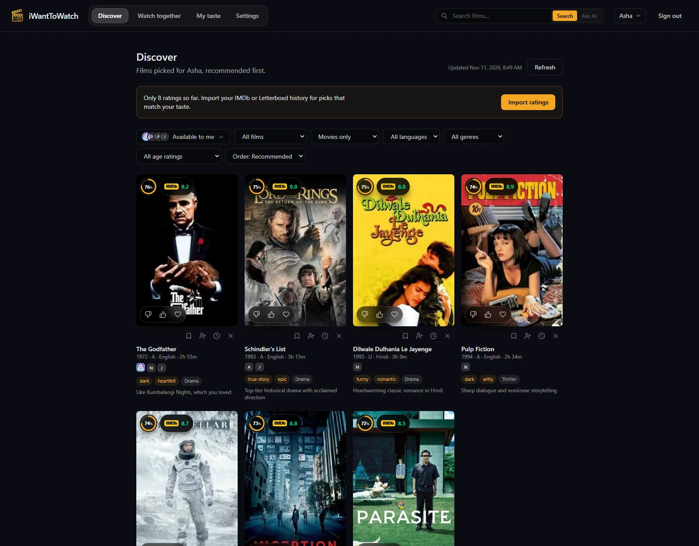
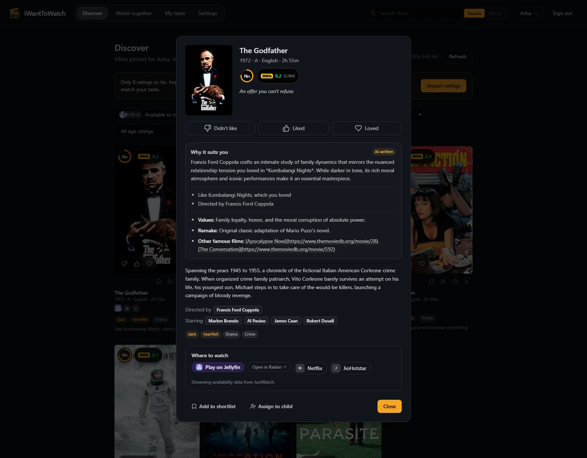
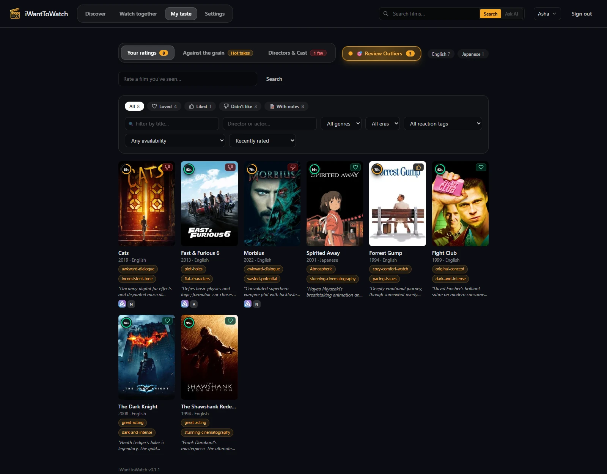
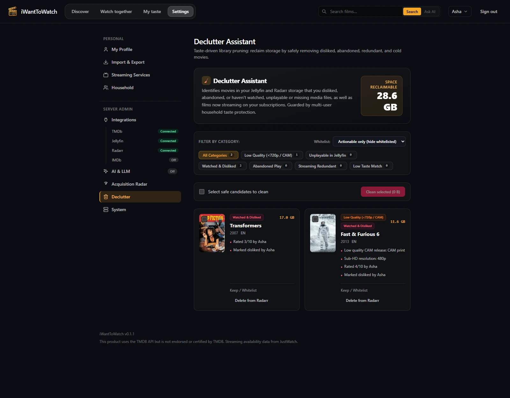
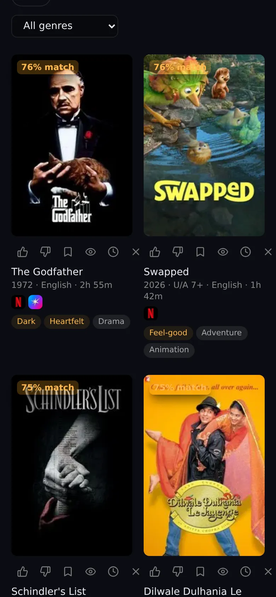

# iWantToWatch

Self-hosted movie recommender that learns your taste from your own history — Jellyfin, IMDb, Letterboxd, and Netflix — and only suggests films you haven't seen and can actually watch tonight, on your Jellyfin server or your streaming subscriptions.

> **Status:** Active development with 54+ releases past v0.1.0; see the [changelog](CHANGELOG.md). Includes the web app, native mobile companion app (Android & iOS), Radarr integration, Library Declutter Assistant, Acquisition Radar, and Outlier calibration.



## Features

### Discover & Tailored Feed
- **Only what you can watch:** Pick your country and the streaming services you subscribe to (Netflix, Prime Video, JioHotstar, Apple TV, …); the feed shows films available on them or already in your Jellyfin library, with stacked badges per platform. Free and ad-supported services wait behind their own filter.
- **Modern UI & poster capsules:** Radial circular progress rings show match percentages on a dark disc alongside color-coded glassmorphic IMDb badges (with live vote counts). Floating frosted glass reaction capsules on each poster let you react with one tap (Didn't like 👎 / Liked 👍 / Loved ❤️).
- **Rich filtering & sorting:** Filter the feed by streaming availability, personal shortlist, content type (defaulting to "Movies only", excluding stand-up specials, live concerts, and shorts), language, genre, and cumulative regional age ratings (e.g. "Rated PG-13 & under"). Sort by Recommended feed diversity, Highest match, IMDb score, Newest, Oldest, or Shortest runtime.
- **Combined Search & Ask AI:** Persistent header search bar with segmented toggles to instantly search any film in the catalogue or submit natural-language requests (such as *"a light Malayalam comedy under 2 hours"*).
- **Instant feedback loop:** React directly on any card to refine recommendations in seconds; bookmark to shortlists, assign to child profiles, or snooze/dismiss titles.



### Unified Film Details
- **Unified movie popup:** Standardized title details across Discover, My Taste, and Declutter Assistant with full metadata, trailers, runtime, and certifications.
- **"Why it suits you" critique:** Grounded personal critiques combining recommender algorithmic match reasons with AI-generated Hook + Caveat evaluations.
- **Interactive Cast & Director chips:** Click any director or actor to explore personal affinity stats, favorite creators, and scrollable filmographies ("Available to watch" vs "All filmography").
- **AI Themes & Values note:** Bullet-point parent notes highlighting core moral values, remake status, and clickable links to famous other works by the director.
- **Streaming & Media integration:** Direct playback links for Jellyfin, external links to streaming providers, and live Radarr tracking with manual download triggers.



### Taste Engine & Calibration
- **Criticker-style taste scoring:** Nearest-neighbour and ridge regression models over cast, directors, keywords, genres, languages, and decades, calibrated per user against held-out ratings.
- **Standardized 3-point reaction scale:** Discrete reaction percentiles (Loved: 95%, Liked: 70%, Didn't like: 15%) across imported ratings and in-app reactions, eliminating score compression.
- **Review Outliers Calibration Assistant:** A glowing beacon button alerts you to ratings that strongly diverged from predicted taste. Verify unexpected ratings, confirm rewatchability, or clear stale ratings while keeping watched status. Confirmed dislikes gain an elevated 1.5× weight in future modeling.
- **Expanded tags & mixed sentiment caveats:** Highlight up to 3 strengths and 2 caveats (from 30+ craft and critique tags such as *stunning cinematography*, *cozy comfort watch*, *pacing issues*, or *flat characters*).
- **"Against the grain" (Hot takes):** AI analysis of films where your rating clashed with general audience consensus, explaining why your unique taste diverged.
- **Regional cinema first-class:** Multilingual metadata and per-language quality norms ensure regional films (Malayalam, Tamil, Korean, Japanese) aren't crowded out by Hollywood blockbusters.



### Smart Media Lifecycle: Acquisition Radar & Declutter Assistant
- **Acquisition Radar & Theatrical Tracking:**
  - *Missing from Streaming:* Surfaces high-match recommendations currently unavailable on any subscribed streaming platform or Jellyfin, ready for Radarr download.
  - *Now in Theaters:* Tracks upcoming theatrical releases, automatically monitoring them in Radarr for future digital/physical release while avoiding low-quality CAM rips.
- **Library Declutter Assistant:**
  - *Taste-driven prune detection:* Scans Jellyfin and Radarr to identify reclaimable disk space across 6 categories: Low Quality (<720p or CAM prints), Watched & Disliked, Abandoned Play (<20% playback >30 days ago), Cold Hoard / Low Match (unwatched >6 months, match <35%), Streaming Redundant (streamable on active subscriptions), and Unplayable in Jellyfin.
  - *Household Protection Guardrails:* Automatically shields titles from deletion if any other household member or child has shortlisted, favorited, rated $\ge 7/10$, or scored a high unwatched match ($\ge 70\%$).
  - *Combinable multi-category filters:* Multi-select category chips with ALL/ANY boolean modes, whitelist status filtering, and safe batch deletion via Radarr API with dry-run verification.

### Radarr Integration
- **Two-way integration:** Connects to Radarr via API to monitor download status, quality profiles, and free disk space.
- **Language-specific root folders:** Automatically routes downloads to designated root folders based on movie spoken language (e.g., Malayalam, Tamil, English).
- **Shortlist sync & batch triggers:** One-click batch queuing of unstreamable shortlisted movies from personal Discover shortlists or Watch Together group shortlists.

### Household & Watch Together
- **Watch together:** Picks scored for everyone watching, algorithmically weighted to minimize group misery so nobody dislikes the selection.
- **Friend taste cards & links:** Share revocable taste links or static taste card files with friends on other servers to blend tastes without shared logins.
- **Guest phone voting:** Host starts a guest session with a QR code; guests vote Yes, Maybe, or No from their phones without needing an account.
- **Child profiles:** Parent-managed profiles with birth-year certificate limits (e.g. U/A 7+, PG), removable age restriction filters, and adult film assignment.

### Native Mobile Apps & PWA
- **Mobile companion app:** Native Expo / React Native companion app for Android and iOS in `mobile/`, with automated GitHub Actions CI generating downloadable Android APKs.
- **Installable web app (PWA):** Add to home screen from Safari, Chrome, or Edge for a full-screen, standalone experience.



### Privacy, AI & Under the Hood
- **Optional AI (Google Gemini or local Ollama):** Predicts ratings, tags nuanced moods, writes "Why this?" critiques, sums up taste in plain words, and drafts themes notes for parents. Everything works completely without AI. Prompts carry only metadata and aggregated taste summaries—never usernames or server details.
- **Your data stays yours:** Single container, SQLite (WAL mode) with `sqlite-vec` embeddings; runs alongside Jellyfin on NAS or home server. Automatic daily database backups and pre-upgrade snapshots.
- **Debugging & MCP:** Built-in read-only Model Context Protocol (MCP) server for inspecting feeds, user taste, and server health.

## Quick Start (Docker)

```sh
git clone https://github.com/sinoop/iwanttowatch.git
cd iwanttowatch
docker compose up -d
```

Open `http://<your-server>:8080` to complete the quick setup wizard and create the admin account. In Settings, add a free [TMDb API key](https://www.themoviedb.org/settings/api). Connect Jellyfin, Radarr, streaming subscriptions, or optional AI directly in the redesigned Settings dashboard.

See the [installation guide](docs/install.md) for full instructions, reverse proxy setup (Caddy/Nginx), and Jellyfin webhook configuration.

### Updating

```sh
git pull
docker compose pull
docker compose up -d
```

The server automatically makes a database backup before applying migrations on startup.

## Project Structure

| Path | Description |
| --- | --- |
| `server/` | Python API server (FastAPI, SQLAlchemy 2, Alembic, SQLite, APScheduler) |
| `web/` | Web application (React 19, TypeScript, Vite, Tailwind CSS, TanStack Query) |
| `mobile/` | Native companion app for Android and iOS (React Native, Expo, OpenAPI client) |
| `packages/api-client/` | Shared TypeScript API client generated from server OpenAPI schema |
| `Dockerfile`, `docker-compose.yml` | Multi-architecture container deployment (amd64, arm64) |

See [CONTRIBUTING.md](CONTRIBUTING.md) and [AGENTS.md](AGENTS.md) for local development workflows.

## Roadmap & Progress

- [x] **Phase 0–4:** Core catalog (TMDb), IMDb/Letterboxd/Netflix imports, Jellyfin live sync, streaming availability, Criticker-style taste models, and discovery feed.
- [x] **Phase 5a–b:** Feedback loop, Watch together group scoring, taste links/cards, and guest phone voting.
- [x] **Phase 5c:** Household child profiles with birth-year certificate limits, profile switching, and parental film assignment.
- [x] **Phase 5d:** Shortlists, Discover filter controls, stacked platform chips, and adult certificate filters.
- [x] **Phase 5e:** Radarr connector, language-based root folders, and shortlist batch download sync.
- [x] **Phase 5f:** Smart Media Lifecycle: Acquisition Radar (Missing from Streaming + Theatrical Tracking) and Library Declutter Assistant with household protection guardrails.
- [x] **Phase 5g:** Cast & Director Affinity, PersonDialog filmography, explicit favorite people, and My Taste people tab.
- [x] **Taste & UI Polish:** Standardized 3-point reaction scale, Review Outliers calibration assistant, expanded craft/critique caveats vocabulary, radial match disc, glass poster rating capsules, and Radarr-style settings layout.
- [x] **Mobile Companion (Phase 1):** Native Expo mobile companion app with automated Android APK release builds.
- [ ] **Next:** TV 10-foot client (Android TV / Apple TV) and Trakt connector.

The complete implementation plan is in [docs/plan.md](docs/plan.md).

## Licence and Trademark

iWantToWatch is free software: you can redistribute it and/or modify it under the terms of the [GNU Affero General Public License v3.0 or later](LICENSE).

The iWantToWatch name and logo are trademarks; see [TRADEMARK.md](TRADEMARK.md) for usage policies.
