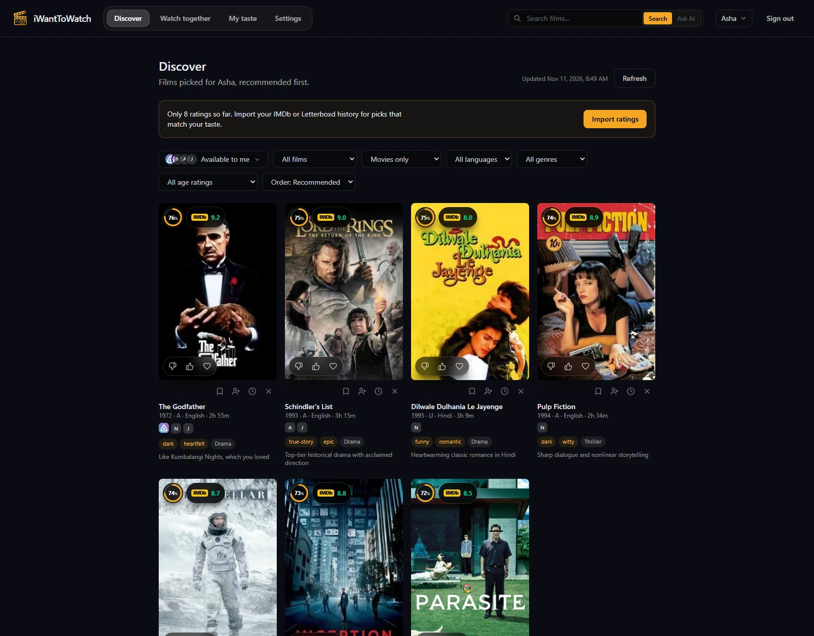
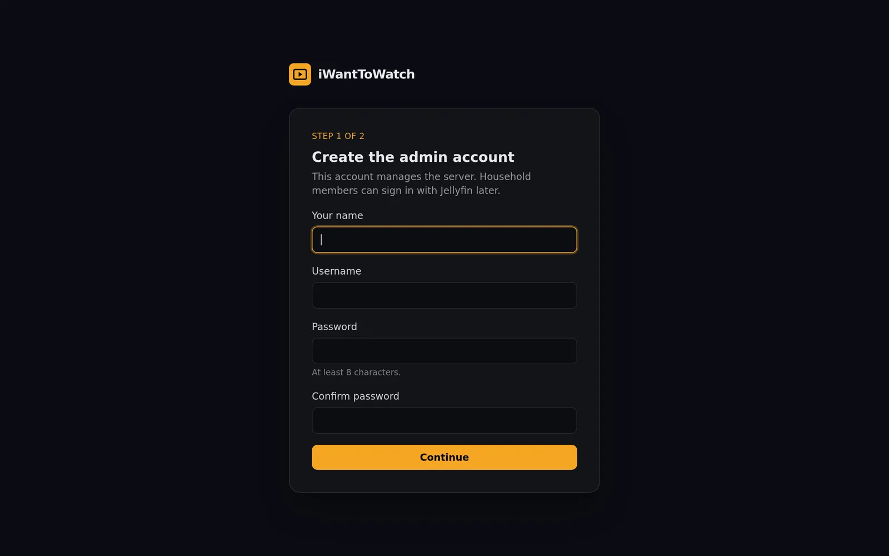
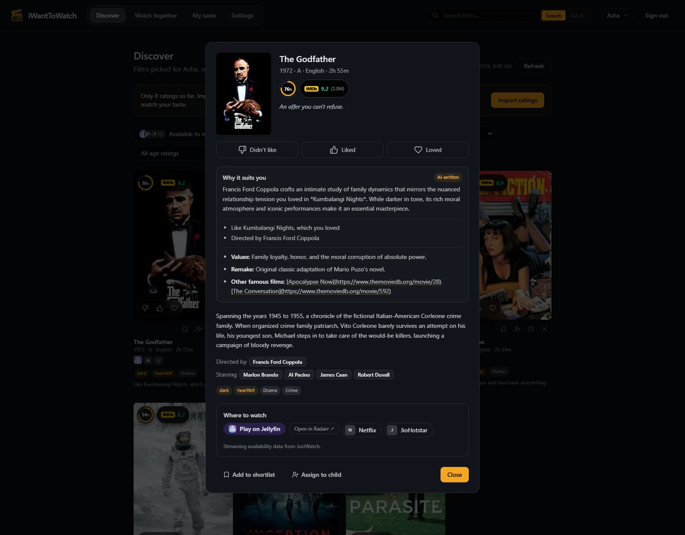
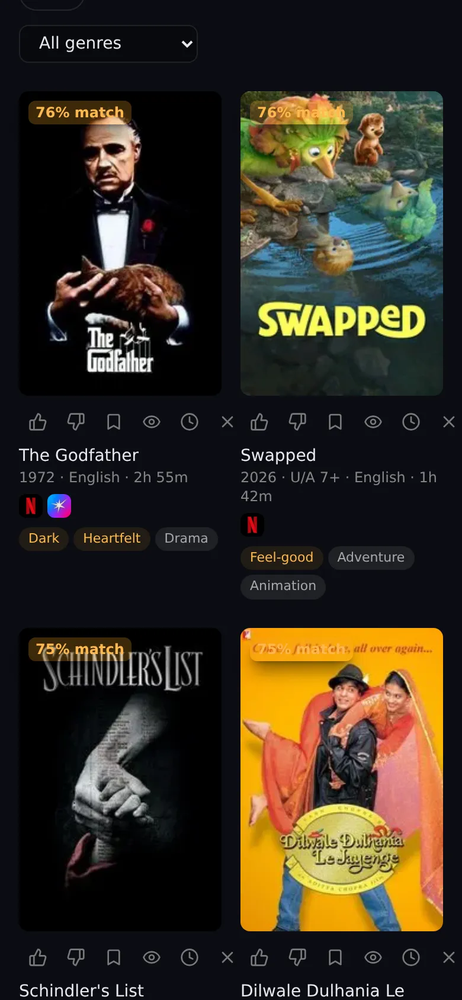

# Installing iWantToWatch

iWantToWatch runs as one Docker container with an SQLite database. It's light enough to sit beside Jellyfin on a home server, a NAS, or a Raspberry Pi 4 or 5. The images are built for amd64 and arm64.



## What you need

- Docker with the Compose plugin.
- A free [TMDb](https://www.themoviedb.org/signup) account for movie details. Its API key is free for personal use.
- Optional: a Jellyfin server, the streaming services you pay for, and a Google Gemini key or a local [Ollama](https://ollama.com) model for the AI features.

## 1. Start the container

```sh
git clone https://github.com/sinoop/iwanttowatch.git
cd iwanttowatch
docker compose up -d
```

Compose pulls `ghcr.io/sinoop/iwanttowatch:latest` and keeps your data in the `iwanttowatch-data` volume. To stay on a release instead of following `main`, change `image:` in `docker-compose.yml` to a version tag such as `ghcr.io/sinoop/iwanttowatch:0.1`.

Without Git, save [`docker-compose.yml`](../docker-compose.yml) in an empty folder and run `docker compose up -d` there.

## 2. Create the admin account

Open `http://<your-server>:8080`. The setup wizard asks for the admin's name, username, and password, then your country and the languages you watch in.



## 3. Add a TMDb key

In **Settings → TMDb**, paste the API key or the API Read Access Token from [themoviedb.org/settings/api](https://www.themoviedb.org/settings/api) and choose **Check and save**. Nothing else works until this is set.

## 4. Tell it your taste

Each person does this for themselves, on **My taste → Import ratings**:

| Source | How to export |
| --- | --- |
| IMDb | Your ratings → the ⋮ menu → Export, then upload `ratings.csv` |
| Letterboxd | Settings → Data → Export your data, then upload the ZIP (or `ratings.csv` / `watched.csv` from it) |
| Netflix | Account → Profiles → your profile → Viewing activity → Download all, then upload `NetflixViewingHistory.csv` |

Titles that don't match a film on their own wait in a review queue on the same page. Ratings you give in the app, and films you watch on Jellyfin, count too. With no ratings the feed shows well-loved films; from about 15 ratings it follows your taste.

## 5. Connect Jellyfin (optional)

1. In Jellyfin, open **Dashboard → API Keys**, add a key, and copy it.
2. In iWantToWatch, open **Settings → Jellyfin**, enter the server URL as iWantToWatch's container can reach it (such as `http://192.168.1.10:8096`), paste the key, and choose **Connect**.
3. Each person links their Jellyfin account under **Settings → Your Jellyfin account**, or signs in with their Jellyfin username and password; the first Jellyfin sign-in creates their account.

Libraries, watched films, and favourites then sync every 30 minutes. For updates within a second, add the Webhook plugin:

1. In Jellyfin, open **Dashboard → Plugins → Catalog**, install **Webhook**, and restart Jellyfin.
2. Open the Webhook plugin and choose **Add Generic Destination**.
3. Set **Webhook Url** to the address shown under **Settings → Jellyfin** in iWantToWatch. It contains a secret token; Jellyfin must be able to reach it.
4. Tick the notification types **Item Added**, **Item Deleted**, **Playback Stop**, and **User Data Saved**; the item type **Movies**; and **Send All Properties**. Save.

The Jellyfin section then shows when the last webhook arrived.

## 6. Pick your streaming services

In **Settings → Your streaming services**, choose your country and the services you pay for. The feed shows films on those services or on your Jellyfin server. Free and ad-supported services stay behind their own chip on Discover, and renting or buying doesn't count. Availability comes from TMDb, using JustWatch's data, and is rechecked every few days.



## 7. Turn on the AI (optional)

Everything works without AI. With it, the app also predicts how you'd rate the top of your feed, suggests a few films of its own, tags moods, explains "Why this?", sums up your taste, and answers requests such as "a light Malayalam comedy under 2 hours".

In **Settings → AI writing**, set up either or both providers and put them in the order to try:

- **Google Gemini:** an API key from [Google AI Studio](https://aistudio.google.com/apikey), which has a free tier, and a model. Flash-Lite is the cheapest and fastest.
- **Ollama:** the URL of your Ollama server, such as `http://192.168.1.10:11434`, and a model you've pulled. A small model works but writes less well.

Prompts carry films and an aggregated taste summary, never usernames or server details. Admins can read every call under **Settings → AI activity**.

## 8. Invite your household

**Settings → Household** creates a one-time invite link, valid for a week. **Settings → Child profiles** adds parent-managed profiles with an age limit by certificate and a parent PIN. **Watch together** finds films for everyone in the room, including guests voting from their phones.

## Install it as an app

On a phone, open iWantToWatch and choose **Add to Home Screen** (Safari) or **Install app** (Chrome); on a computer, use the install icon in Chrome's or Edge's address bar. Android and desktop browsers only offer this over HTTPS, so put iWantToWatch behind a reverse proxy with a certificate. With [Caddy](https://caddyserver.com):

```caddy
movies.example.com {
    reverse_proxy 192.168.1.10:8080
}
```

The reverse proxy you already use for Jellyfin works the same way.



## Updating

```sh
git pull                 # picks up changes to docker-compose.yml
docker compose pull
docker compose up -d
```

The server copies its database before running an upgrade's migrations. To build from your checkout instead of pulling, run `docker compose up -d --build`.

## Backups and restore

The server backs up its database every day and before each upgrade, keeping the newest 7, in `backups/` inside the data volume. Admins see them in **Settings → Server backups**, where they can back up now and download a copy. To keep backups elsewhere, mount a folder and set `IWANTTOWATCH_BACKUP_DIR` (see the comment in `docker-compose.yml`).

To restore one, stop the server and copy it over the database:

```sh
docker compose stop
docker compose run --rm --no-deps --entrypoint sh iwanttowatch -c \
  'cp /data/backups/iwanttowatch-20261108-093000.db /data/iwanttowatch.db && rm -f /data/iwanttowatch.db-wal /data/iwanttowatch.db-shm'
docker compose up -d
```

Each person can also export their own ratings, watches, and feedback as JSON under **Settings → Your data**, and import it on another server.

## Settings from the environment

Everything a household configures lives in the database and is set in the web app. The container reads only these:

| Variable | Default | What |
| --- | --- | --- |
| `IWANTTOWATCH_DATA_DIR` | `/data` | Database, secret key, and backups |
| `IWANTTOWATCH_BACKUP_DIR` | `/data/backups` | Where daily backups go |
| `IWANTTOWATCH_SECRET_KEY` | generated in `/data/secret_key` | Signs sign-in sessions; changing it signs everyone out |
| `IWANTTOWATCH_PORT` | `8080` | Port inside the container; to use another port on the host, change the left side of `ports:` instead |
| `IWANTTOWATCH_TMDB_BASE_URL` | `https://api.themoviedb.org/3` | For a proxy or a local stub |
| `TZ` | `UTC` | Time zone for logs and backup times |

## Troubleshooting

- **No picks:** check the TMDb key, import or give some ratings, and pick at least one streaming service or connect Jellyfin. **Everything** on Discover shows films wherever they stream.
- **Jellyfin won't connect:** use an address the container can reach. `localhost` inside the container is the container itself; use the server's LAN address, or put both containers on one Docker network and use Jellyfin's container name.
- **Webhooks don't arrive:** the same applies in reverse: Jellyfin must reach iWantToWatch's address. Without webhooks, changes still arrive within 30 minutes.
- **Permission errors with a host folder:** the container runs as uid 1000, so `chown 1000:1000` the folder first, or keep the named volume.
- **Logs:** `docker compose logs -f iwanttowatch`.
