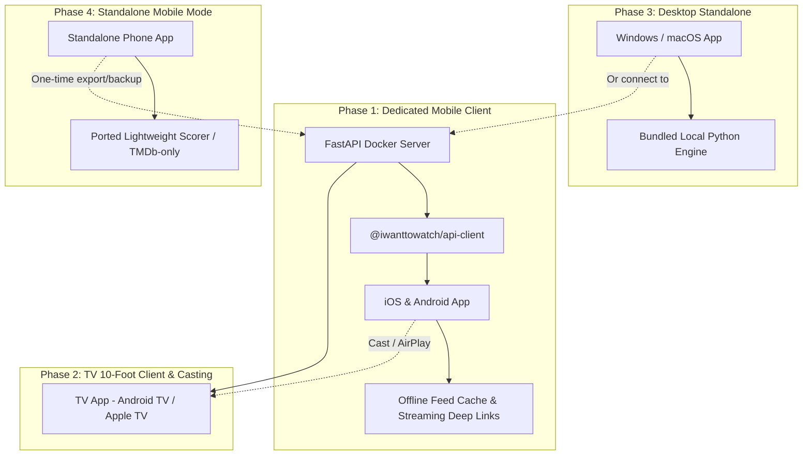

# Multi-Device & Mobile Architecture Strategy

This document outlines the architectural analysis, trade-offs, and implementation roadmap for supporting mobile devices (iOS / Android), TV platforms (Android TV, Apple TV), and desktop environments (Windows / macOS) alongside the primary Docker-based self-hosted server.

---

## 1. Executive Summary

iWantToWatch is designed around a self-hosted server runtime (Python 3.12, FastAPI, SQLite with WAL mode, background jobs, and a recommender blending nearest neighbours and ridge regression).

Expanding to mobile and TV form factors brings two distinct deployment topologies:
1. **Client-Server Mode (Self-Hosted Companion):** The mobile, desktop, or TV app connects directly to the user's running Docker container. All computation, sync (Jellyfin, TMDb, Radarr), and scoring happen on the server.
2. **Standalone Mode (Local-First / Serverless):** The app runs entirely on the client device without requiring a Docker host or NAS, computing recommendations locally from TMDb and user-entered/imported ratings.

While standalone mode significantly lowers the barrier of entry for non-technical users, attempting to run the complete Python backend on mobile OSes poses severe runtime and lifecycle issues. Therefore, the project adopts a **phased roadmap** starting with a rock-solid, native mobile client connected to the Docker server, followed by TV companions, bundled desktop packages, and eventually a lightweight portable client-side engine.

---

## 2. Technical Feasibility & Trade-Off Analysis

### A. Phone App (iOS / Android)

#### Standalone Mobile (Pros & Cons)
- **Pros:**
  - Zero server setup required (no Docker, NAS, or port forwarding/Tailscale).
  - Frictionless onboarding for casual streaming users (select regions, pick streaming providers, import Letterboxd/IMDb CSV).
  - Reliable offline discovery during travel or spotty connectivity.
- **Cons & Constraints:**
  - **Python Runtime Restrictions:** The server backend relies on Python 3.12, `numpy`, `scipy`/scikit-learn math, `sqlalchemy`, and `alembic`. Embedding Python into iOS or Android apps via bridges (Chaquopy, Pyto, Kivy) results in bloated app bundle sizes (>150MB+), high memory overhead, battery drain, and recurring risks with Apple App Store review guidelines regarding interpreted/embedded runtimes.
  - **Mobile Background Lifecycle:** Server jobs run 24/7 (30-minute Jellyfin polls, daily candidate refreshes, availability updates). Mobile operating systems (especially iOS and modern Android Doze mode) terminate background tasks after seconds to minutes. Background daemons are not permitted; candidate gathering and feed scoring must be executed lazily on app launch.
  - **Recommender Maintenance:** Supporting standalone mobile requires either porting the candidate gathering and ridge/neighbour algorithms to TypeScript/WebAssembly, Swift/Kotlin, or Rust, creating a dual-codebase maintenance burden.

#### Client-Server Companion (Recommended for Phase 1)
- The mobile app acts as a rich client to the self-hosted API using the generated TypeScript client (`packages/api-client`).
- Computation, storage, and 24/7 library sync stay on the server.
- The mobile client adds push notifications, deep links to streaming apps (Netflix, Prime, Disney+) and Jellyfin, offline caching of the current feed, and responsive gestures.

---

### B. TV App (Android TV / Apple TV / FireTV)

#### Routing Data through the Phone (Anti-Pattern)
Routing TV requests through a phone running as a local HTTP or WebSocket server is fragile in practice:
- **Mobile Sleep / Wi-Fi Suspension:** When the phone locks or enters deep sleep, mobile OSes suspend local network sockets and listeners. The TV interface would freeze, lag, or fail to load.
- **Local Network Isolation:** Subnet isolation, guest networks, and mobile OS local-network permissions frequently disrupt direct device-to-device communication on home Wi-Fi.

#### Direct Server Connection vs. Casting
- **Connected Household:** The TV app should be a dedicated 10-foot interface client connecting directly to the Docker server API. This allows family members to use the TV remote independently without needing a specific unlocked phone.
- **Standalone Companion (Casting):** If the user runs the app only on their phone (without Docker), the TV should serve as a **Cast Target** (Google Cast / Apple AirPlay / custom receiver) where the phone explicitly pushes playback links or titles to the TV, rather than the TV polling the phone as a persistent server.

---

### C. Desktop App (Windows / macOS)

- Unlike mobile devices, desktop operating systems do not place aggressive restrictions on background processes or embedded Python runtimes.
- A Windows/macOS desktop app can easily support both modes:
  1. **Standalone:** Package the FastAPI server + SQLite database alongside a lightweight UI container (via Tauri, PyInstaller, or Electron) running locally on `localhost:8000`.
  2. **Connected:** Configure the desktop UI to point to a remote Docker server instance.

---

### D. Data Synchronization & Migration Strategy

To avoid the immense complexity of two-way bi-directional synchronization (CRDTs, multi-master conflicts) between mobile SQLite and server SQLite:
- **No bi-directional continuous sync between standalone client and server.**
- A clean **"Export / Migrate to Server"** mechanism: A standalone mobile user can export their profile, ratings, watches, and feedback as standard JSON (using the existing export/import schema in `Settings -> Your data`) and restore it seamlessly into a new Docker server instance when they decide to self-host.

---

## 3. Phased Implementation Roadmap

### Phase 1 — Dedicated Mobile App (Client-Server)
- **Goal:** Native mobile experience for iOS and Android connecting to the self-hosted Docker server.
- **Architecture:**
  - Built with **React Native / Expo** (or Capacitor) consuming the generated `@iwanttowatch/api-client`.
  - Secure server URL configuration and authentication (Jellyfin credentials or local admin).
  - Feed browsing, watchlist/shortlist management, rating, and dismiss actions.
  - Native deep linking: Tapping a provider chip opens the movie directly in Netflix, Prime Video, Disney+, or Jellyfin Mobile.
  - Local client caching (TanStack Query / MMKV / SQLite) for offline feed browsing.

### Phase 2 — TV 10-Foot Interface & Casting
- **Goal:** Lean-back couch experience.
- **Architecture:**
  - Dedicated Android TV / Apple TV client designed for D-pad navigation.
  - Direct connection to the Docker server for household browsing and group picks ("Watch Together").
  - Mobile app cast integration (Chromecast / AirPlay) to push title cards or launch streams on the TV.

### Phase 3 — Standalone Desktop Client (Windows & macOS)
- **Goal:** Zero-configuration desktop experience.
- **Architecture:**
  - Bundled local Python backend + embedded SQLite database using Tauri or PyInstaller.
  - Toggle between "Local Engine" and "Connect to Remote Server".

### Phase 4 — Standalone Mobile Engine (Local-First)
- **Goal:** Allow mobile app use without any server infrastructure.
- **Architecture:**
  - Lightweight client-side candidate gathering via direct TMDb API queries.
  - Ported scoring algorithm (compact WebAssembly / TypeScript) running nearest-neighbour and cosine affinity locally.
  - One-click migration path to export ratings and data to a self-hosted Docker server.
