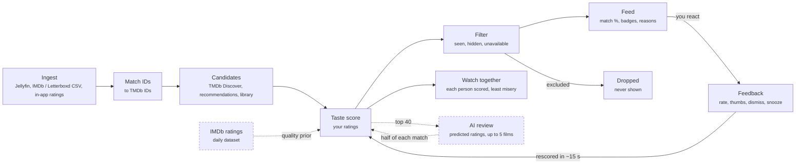

# iWantToWatch — Web App implementation plan

**Goal:** a self-hosted, open-source service that learns your taste from Jellyfin, IMDb/Letterboxd, and Trakt, then suggests unwatched movies you can actually play tonight — on your Jellyfin server or on the streaming subscriptions you have. Web App first; the backend API is designed so the Android and iOS apps reuse it unchanged.

This file is the plan's source of truth: update it in the same commit as the work it describes. Sections 1–8 record the original design; where the code took a different path, the milestones in section 9 say so.

## Pipeline

Suggestions are ranked by your own ratings, and only unwatched films you can play reach the feed. Dashed boxes are optional inputs, skipped when not configured.



- **Ingest:** Jellyfin webhooks plus a 30-minute reconcile poll record plays, favourites, and the library with no manual logging. IMDb and Letterboxd CSV imports add historical ratings, and in-app ratings add a reaction, up to three tags for what you liked or didn't, and an optional note.
- **Match IDs:** every source resolves to one TMDb movie ID. Jellyfin carries provider IDs, IMDb rows map through TMDb `/find`, and Letterboxd rows match on title and year, with a review queue for ambiguous rows.
- **Candidates:** unwatched Jellyfin films, TMDb Discover per subscribed service and region, TMDb recommendations of your top-rated films, and per-language discovery so Malayalam or Korean films aren't crowded out. Films the LLM added at the last build stay among them.
- **Taste score:** a per-user model predicts where each film would land among your own ratings: nearest neighbours blended with a ridge model on cast, crew, keywords, language, and decade, plus a quality prior from IMDb (or TMDb) votes judged within each language. An optional birth year lowers films from before it. With an LLM configured, it then reviews the top 40 (playable ones first) without seeing their match: it predicts the rating you'd give each, from your taste summary and what you said about films, and may add up to 5 films of its own, which are matched to TMDb and scored the same way. Its predicted rating becomes a percentile of your own ratings and makes up half of the match, a weight checked against held-out ratings with `iwanttowatch eval-llm`. Match % is that predicted percentile.
- **Filter:** drops anything watched or rated in any source, dismissed or snoozed, and anything not on the platforms picked with the chips: by default, anything neither on your Jellyfin server nor on a service you subscribe to (or a free one) in your region.
- **Feed:** re-ranked for variety and shown as cards with match %, where to watch, IMDb rating, genre and mood tags, and a reason such as "Like Kumbalangi Nights, which you rated highly" or the AI's own reason.
- **Feedback:** ratings and thumbs become training labels; dismissing or snoozing hides a film. The feed is rescored about 15 seconds after you stop.
- **Watch together:** the same model scores each film for everyone watching; the group order penalises films anyone is likely to dislike.

## 1. Key decisions

| Decision | Choice | Why |
| --- | --- | --- |
| Backend | Python 3.12, FastAPI, SQLAlchemy 2 + Alembic | Best ecosystem for the recommender (numpy, scikit-learn, ONNX embeddings); FastAPI emits OpenAPI, which the web and mobile clients are generated from |
| Database | SQLite (WAL mode) + `sqlite-vec` for embeddings, on a `/data` volume | Zero extra container, tiny idle footprint, easy backups. SQLAlchemy keeps PostgreSQL possible later, but v1 ships SQLite only |
| Background jobs | APScheduler inside the API process | No Redis/Celery/worker container; jobs are small and per-household |
| Embeddings | `fastembed` (ONNX Runtime, no PyTorch) with a multilingual model such as `paraphrase-multilingual-MiniLM-L12-v2` | Runs on CPU on a NAS; multilingual so Malayalam/Tamil/Hindi overviews embed as well as English. Loaded only while a job runs, then released |
| LLM | Optional, behind one `LlmProvider` interface with two backends: **Ollama** (local sidecar, compose profile) or **Google Gemini** (API key). Never required | Used only for explanations, mood tags, and natural-language requests; the core engine works without either. Ollama keeps everything on your server; Gemini needs no local RAM/GPU but sends data to Google, so it is opt-in |
| Frontend | React + TypeScript + Vite, TanStack Query, Tailwind; built to static files served by FastAPI | One container, one port. A PWA manifest makes it installable on phones before native apps exist |
| API client | `openapi-typescript` generated client in `packages/api-client` | Shared later by the mobile apps |
| Canonical movie ID | TMDb movie ID | Jellyfin and Trakt carry it; IMDb IDs map to it through TMDb `/find` |
| Container base | `python:3.12-slim` (Debian), multi-arch amd64 + arm64 | Alpine (musl) lacks prebuilt wheels for numpy/onnxruntime, which makes builds slow and images larger. Debian slim satisfies the requirement |
| Auth | Sign in with Jellyfin credentials (server-side `AuthenticateByName`), plus a local admin account | Household users map 1:1 to Jellyfin users with no extra passwords |

**Target footprint:** under 150 MB RAM and near-zero CPU at idle without Ollama; image under 400 MB including the embedding model.

## 2. Repository layout

```text
iwanttowatch/
  server/                    FastAPI app (package: iwanttowatch, src layout)
    src/iwanttowatch/
      api/                   REST routes under /api/v1
      db.py                  models (split into a package as it grows)
      migrations/            Alembic, applied on startup
      connectors/            jellyfin/, tmdb/, trakt/, watchmode/, imports/ (imdb, letterboxd)
      catalog/               title metadata, ID matching, caching
      recommender/           features, embeddings, models, candidates, ranking, eval
      jobs/                  scheduler + job definitions
    tests/                   pytest; recorded HTTP fixtures (respx)
  web/                       React app
  packages/api-client/       generated TypeScript client
  Dockerfile, docker-compose.yml   at the root, so `docker compose up` works from a clone
  docs/                      this plan, plus setup guides (Jellyfin webhook, TMDb key, imports)
```

The code ended up flatter: one module per concern under `src/iwanttowatch/` (see `AGENTS.md`).

## 3. Data model (SQLite)

| Table | Purpose / key columns |
| --- | --- |
| `users` | id, display\_name, jellyfin\_user\_id, region (e.g. `IN`), preferred\_languages, is\_admin |
| `titles` | tmdb\_id (PK), imdb\_id, title, original\_title, original\_language, spoken\_languages, origin\_countries, year, runtime, genres, keywords, top cast, directors/writers, overview (+ translated overviews), vote stats, popularity, poster\_path, fetched\_at |
| `title_embeddings` | `sqlite-vec` virtual table: tmdb\_id → vector, model\_version |
| `ratings` | user\_id, tmdb\_id, source (`imdb`, `letterboxd`, `trakt`, `app`, `jellyfin`), raw\_value, value\_10 (normalised 0–10), rated\_at. One effective rating per user/title: latest explicit wins |
| `watch_events` | user\_id, tmdb\_id, source, watched\_at, completion\_pct |
| `library_items` | jellyfin\_item\_id, tmdb\_id, library\_id, visible\_to (users), added\_at, removed\_at |
| `availability` | tmdb\_id, region, provider\_id, monetization (`flatrate`, `free`, `ads`, `rent`, `buy`), fetched\_at |
| `providers` / `user_subscriptions` | provider catalogue per region (from TMDb) and each user's active subscriptions |
| `feedback` | user\_id, tmdb\_id, kind (`up`, `down`, `dismiss`, `snooze`, `seen`), created\_at |
| `scores` | user\_id, tmdb\_id, score, match\_pct, reasons (JSON), model\_version, computed\_at — the precomputed feed |
| `import_jobs` / `import_rows` | uploaded CSVs, per-row match status, review queue for ambiguous rows |
| `api_cache` | key (method + normalised URL), body (compressed), etag, fetched\_at, expires\_at |
| `sync_state` / `job_runs` | per-connector cursors, last success/error, durations — shown on a Status page |

## 4. Connectors

### Jellyfin (primary, zero manual logging)

- **Setup:** admin enters server URL and an API key (Dashboard → API Keys). Each person links their Jellyfin user by signing in to Jellyfin once in Settings, or gets an account by signing in to iWantToWatch with Jellyfin credentials.
- **Initial sync:** per user, page through `/Items` with `IncludeItemTypes=Movie`, `Recursive=true`, `Fields=ProviderIds,...` to get the library that user can see plus `UserData` (Played, PlayCount, LastPlayedDate, IsFavorite, PlayedPercentage).
- **Live updates:** the official Webhook plugin with a Generic destination and "Send All Properties" posting to `/api/v1/webhooks/jellyfin?token=…`. A webhook only names the user and item; that item is then re-read from Jellyfin. Item Added/Deleted trigger a full sync.
- **Reconcile poll:** a full library read every 30 minutes and on startup (a few requests per user even for thousands of films), so no incremental cursor is needed. Webhooks are an accelerator; the poll alone guarantees correctness if a webhook is missed.
- **Signals produced:** watched → exclude + weak positive; favourite → strong positive; abandoned under 20% → weak negative; in library → "On Jellyfin" availability.

### TMDb (metadata, candidates, availability)

- Each self-hoster supplies their own free TMDb API key in the setup wizard. Show the required TMDb attribution.
- Details fetched with `append_to_response=credits,keywords,translations,alternative_titles,external_ids` in one call per title.
- **Availability:** `/movie/{id}/watch/providers` per region (data is from JustWatch; **JustWatch attribution is mandatory** or TMDb may revoke the key). Store only `flatrate`/`free`/`ads` for the strict filter; `rent`/`buy` shown as secondary info.
- **Provider list:** load `/watch/providers/movie?watch_region=XX` and let users pick their services. Do not hard-code IDs (e.g. Netflix 8, Prime Video 119, JioHotstar 2336 today), and group "channel" variants (e.g. Prime Video Channels) under their parent.

### Imports: IMDb, Letterboxd, and Netflix

- **IMDb `ratings.csv`:** parse `Const` (tt-ID), `Your Rating`, `Date Rated`; map via TMDb `/find/{imdb_id}?external_source=imdb_id`. Expect \~100% matches. Column names have changed over time, so parse headers by name, tolerate extra columns, and keep a fixture per known variant.
- **Letterboxd export ZIP:** `ratings.csv` (0.5–5 stars → ×2), `watched.csv`, `diary.csv`, `likes/films.csv`. Rows have Name + Year only, so match with TMDb search on title + year (±1), scoring against original and alternative titles; low-confidence rows go to a review queue in the UI.
- **Netflix `NetflixViewingHistory.csv`** (Viewing activity → Download all, one profile): only Title and the last date watched, in the account's locale (12/31/24, 31/12/24, 31.12.24); day-first vs month-first is whichever keeps the file newest first. Episodes ("Dark: Season 1: Secrets", or three or more colon parts) collapse to one skipped row per series; two-part titles TMDb finds no film for but knows as a show ("Our Planet: Jungles") are skipped too. Films match by title, released no later than the year watched, and count as watched with no rating.
- Re-importing is idempotent (upsert on user + title + source).
- **Automated IMDb sync:** IMDb has no public API, so scraping is out of scope. Users who run IMDB-Trakt-Syncer get IMDb data in automatically via the Trakt connector.

### IMDb ratings (optional, public opinion)

- IMDb's non-commercial datasets include `title.ratings.tsv.gz`: every title's weighted rating and vote count, refreshed daily, free for personal and non-commercial use. No API key.
- On the films iWantToWatch knew about on 2026-11-06, IMDb had 52× more votes than TMDb (median 7,912 vs 151), and 158× more for Malayalam films (6,652 vs 42). TMDb's few votes let a few hundred fans rate a film 8.8 that IMDb rates 6.7.
- An admin turns it on in Settings, which notes IMDb's non-commercial terms. Feed builds download the file at most once every 20 hours and copy the rating and vote count of films in the catalogue; turning it off removes them. The UI credits IMDb while it's on.

### Trakt (optional)

- OAuth device-code flow; each self-hoster registers their own Trakt app (Standard API tier is free).
- Pull `/sync/history/movies`, `/sync/ratings/movies`, `/sync/watched/movies`; use `/sync/last_activities` to skip unchanged data. Respect rate limits (authenticated GET: 500 per 5 min) and `Retry-After`.
- **Caveat:** since July 2026, free Trakt accounts can connect only one Community App. Users already using Trakt with another app (e.g. a Jellyfin Trakt plugin) would need VIP, so iWantToWatch also accepts a **Trakt data export** file as a one-time import. Jellyfin stays the primary live source.

### LLM providers (optional): Ollama or Gemini

- **One interface, two backends.** Recommender code calls `LlmProvider.generate(prompt, json_schema)` and never knows which backend answers. Settings sets up Ollama (base URL + model) and Gemini (API key + model), each checked with a test prompt, and puts the ones in use in an order the admin chooses: the first is always asked first, and the next answers when it fails, such as at Gemini's free daily limit or with Ollama switched off. Each attempt is in the LLM log.
- **Gemini:** calls the Gemini REST API with the user's own key from Google AI Studio and requests structured JSON output. The model name is configurable rather than hard-coded, since Google renames models often. Its free tier has rate limits, so calls go through the same rate limiter, backoff, and circuit breaker as other connectors.
- **Privacy:** prompts contain only title metadata and an aggregated taste summary (e.g. top genres, languages, people), never usernames, Jellyfin URLs, or raw watch history. The Settings page states that Gemini sends this data to Google.
- **Cost control:** results are cached in the DB per title and prompt version, so mood tags and explanations are generated once, not on every page view.
- **Embeddings stay local** (`fastembed`) for both choices. Switching to Gemini embeddings would mean re-embedding the whole catalogue in a different vector space, so it is not part of v1.

### Other availability sources (adapters, off by default)

- **Watchmode:** optional adapter behind the same `AvailabilityProvider` interface for users who want a second source; quota-limited free tier, so only refresh titles shown in the feed.
- **JustWatch direct:** no official public API; not shipped. The adapter interface lets the community add one at their own risk.

## 5. Resilience and caching

- One shared HTTP client per connector with: `api_cache` lookups (TTL per endpoint: title details 30 days, credits/keywords 30 days, watch providers 3 days, discover pages 24 h), conditional requests with ETag where supported, a per-host token bucket and concurrency cap, exponential backoff honouring `Retry-After` on 429/5xx, and a circuit breaker that pauses a failing connector.
- On failure the UI serves the last good data and marks it stale; the Status page shows each connector's last success and error.
- Before a title with stale availability (older than its TTL) appears in the feed, it is rechecked in the background; if the check fails it keeps its last known badge with a "checked N days ago" note.
- Posters are lazily cached to `/data/posters` (w342 size, capped disk usage).
- Nightly SQLite online backup to `/data/backups` (keep 7).

## 6. Recommendation engine

### Labels: turning signals into taste

- Normalise every explicit rating to 0–10, then convert to the user's own **percentile** (Criticker-style), so a generous rater and a harsh rater are comparable and "match %" means "predicted to land in your top X%".
- Implicit signals become low-weight pseudo-labels: favourite ≈ 85th percentile, thumbs-up ≈ 80th, completed but unrated ≈ 60th, thumbs-down ≈ 20th, abandoned ≈ 30th. Explicit ratings always override.

### Features per title

- **Multilingual text embedding** of title, original title, overview, tagline, genres, and keywords.
- **Structured sparse features:** genres, TMDb keywords, directors, writers, top-billed cast, composer, original language, origin country, decade, runtime bucket.
- **Weak priors:** Bayesian-averaged vote and log popularity — normalised **within each original language**, so a well-loved Malayalam film with 300 votes is not treated as obscure next to a Hollywood film with 30,000. The vote is IMDb's when IMDb ratings are on, otherwise TMDb's.

### Candidate generation (nightly + on demand)

Union, de-duplicated, minus already-excluded titles, capped at a few thousand per user:

1. Unwatched movies in the user's Jellyfin libraries.
2. TMDb Discover per subscribed provider (`with_watch_providers`, `watch_region`, `with_watch_monetization_types=flatrate`), across the user's languages, sorted by vote average with a per-language vote-count floor. Each search reads pages until it has 40 films the user hasn't seen (up to 10 pages), so a language whose best films they've mostly watched is searched deeper (2026-11-08: on a real feed whose main language the user had mostly watched, playable films in that language went from 5 to 25).
3. TMDb recommendations/similar for the user's top-rated \~50 titles.
4. Per-language discovery for every language that appears in the user's ratings or settings, so regional cinema is always represented.
5. When an LLM is configured: films it suggests from the user's taste summary, including what they liked or disliked about films in their own words.

### Scoring model (v1, per user, CPU-only)

- **Neighbour score:** for each candidate, the similarity-weighted average percentile of the user's k (≈20) most similar rated films in embedding space. Explainable: "because you rated *Kumbalangi Nights* 9 and *Maheshinte Prathikaaram* 8".
- **Feature score:** a ridge regression on the sparse features trained on the user's labels; learns things like "likes Fahadh Faasil and Dileesh Pothan, dislikes slasher horror".
- **Blend:** weights chosen per user by cross-validation; with few ratings (under \~30) the blend leans on language/genre preferences and quality priors (cold start).
- **Match %:** predicted percentile, calibrated on held-out ratings.
- **Retraining:** full rescoring nightly; after feedback, a debounced (\~30 s) background rescore of that user. Both models train in well under a second for thousands of ratings.

### Filtering, ranking, explanations

- **Hard exclusions:** watched or rated in any source, dismissed, or snoozed (until the snooze ends).
- **"Available only" toggle (default on):** keep a title only if it is in a Jellyfin library visible to the user **or** has a `flatrate`/`free`/`ads` offer on one of the user's subscriptions in their region.
- **Diversity:** MMR re-ranking on embeddings, so the top 20 is not ten near-identical films; optional language mix control.
- **Mood tags:** a curated mapping from TMDb keywords to a small mood vocabulary (feel-good, dark, slow-burn, mind-bending, family, thrilling…); the configured LLM (Ollama or Gemini) can refine tags when enabled.
- **Evaluation:** `iwanttowatch eval` holds out 20% of a user's ratings and reports Spearman correlation and NDCG@20 against a popularity baseline, so contributors can compare models objectively.

### Later model upgrades (not v1)

- Household collaborative filtering once several users have ratings.
- Optional user-downloaded MovieLens data for item-item CF (its licence forbids redistributing it, so it cannot ship in the image).
- LLM re-ranking of the top 100 with the configured LLM (Ollama or Gemini), for natural-language requests like "something light and Malayalam tonight".

## 7. Web App

| Screen | Contents |
| --- | --- |
| Setup wizard (first run) | TMDb key, Jellyfin URL + API key, default region, admin account; tests each connection |
| Discovery feed | Cards: poster, title + original title, year, language, **match %**, availability badges (On Jellyfin, On Netflix, On Prime Video, On JioHotstar), genre and mood tags, one-line reason. Actions: 👍 👎 rate (1–10) · dismiss · seen it. Filters: available-only toggle, providers, languages, genres, runtime, decade |
| Title detail | Overview, cast/crew, where to watch (with JustWatch attribution), "Play on Jellyfin" deep link, why it was suggested |
| My taste | Rating history by source, imports, review queue for unmatched rows, top genres/languages/people learned |
| Settings | Region, subscriptions, languages, connectors (Jellyfin, Trakt, Watchmode), LLM provider (None / Ollama / Gemini), data export |
| Status | Connector health, last sync, job history, cache stats |

**API (REST, `/api/v1`):** `auth/*`, `me`, `settings`, `imports` (upload, status, review), `ratings`, `feed` (paginated, filter params), `titles/{tmdb_id}`, `feedback`, `connectors/*`, `webhooks/jellyfin`, `status`. The feed reads from the precomputed `scores` table, so it stays fast on slow hardware.

## 8. Deployment

- One image, `iwanttowatch`, built in two stages: Node builds `web/`, then a `python:3.12-slim` runtime with the static files and the embedding model baked in. Runs a single uvicorn worker as a non-root user, with a `/healthz` healthcheck.
- `docker-compose.yml`: the `iwanttowatch` service with a `./data:/data` volume and port 8080; an `ollama` service behind a `llm` profile.
- Configuration: a few env vars (`IWANTTOWATCH_SECRET_KEY`, `IWANTTOWATCH_BASE_URL`); everything else via the setup wizard, stored in the DB with secrets encrypted by the secret key.
- Publish multi-arch images (amd64, arm64) on each tagged release.

## 9. Milestones

Completed milestones (Phases 0–5d, 5f, 5g, 7, and completed Phase 6/Mobile v1 items) are recorded in `CHANGELOG.md` and git history. Only remaining and newly planned items are tracked below.

### Phase 5e — Radarr integration (remaining)

- [ ] **Phase 3 — Background auto-downloader:** Autonomous downloader for top recommendations scoring $\ge 85\%$ match that are not available on any streaming platform or Jellyfin, safeguarded by strict controls (weekly download caps, minimum vote floors, and physical/digital release availability filters).

### Phase 6 — Optional integrations and polish (remaining)

- [ ] Trakt (device flow, history/ratings pull, export-file import)
- [ ] Watchmode adapter
- [ ] Critic scores (Rotten Tomatoes, Metacritic) through OMDb with a free key; thin coverage of Indian films
- [ ] Google sign-in, optional, for admins who set up their own OAuth client (Netflix offers no sign-in for other apps)
- [ ] Optional / skipped — TMDb or IMDb IDs in LLM prompts: evaluated 2026-11-08 and left out. LLMs identify films from natural-language metadata (`Title / Original Title (Year, language, director)`) rather than arbitrary numeric TMDb IDs or `tt` IMDb IDs, which add token overhead and hallucinated IDs; candidate prompts (`review_films`, `films_for_request`, `tag_moods`) already map short 1..N indices back to `tmdb_id` in Python, and free-form LLM additions resolve through `find_by_title(tmdb, title, year)`
- [ ] UI translations, docs

### Phase 8 — Roadmap & New Ideas (2026-11-13)

#### Batch 1 — Quick Wins (High Impact, Low Effort)

- [x] **Popularity sort in Actor/Director "All filmography" (#8):** Sort `PersonCredit` filmography by `popularity` / `vote_count` descending by default instead of newest-first (so iconic films appear at the top rather than unreleased projects or obscure cameos), with an optional sort toggle (`Popular` / `Newest` / `Top Rated`) (2026-11-13).
- [x] **Year-range filter (#3):** Extend the existing `decade` filter on Discover and My Taste (`api/feed.py`, `api/library.py`, `Discover.tsx`, `Taste.tsx`) to support arbitrary `year_min` and `year_max` bounds alongside quick decade presets (2026-11-13).
- [x] **HTTPS & Tailscale support (#4, #5):** Document and provide compose/proxy examples for Tailscale (host or sidecar, zero app changes) and `tailscale serve` / Caddy reverse proxy for automatic HTTPS certificates, and verify CORS / `X-Forwarded-Proto` / mobile HTTPS MagicDNS compatibility (2026-11-13).

#### Batch 2 — Core UX & Mobile

- [x] **Actor + Director dual-role handling in filmography (#7):** Surface combined role badges (e.g. `Director · as <Character>`) in `PersonDialog.tsx` when someone both directed and acted in a film, and add role filter tabs (`All`, `Directed`, `Acted`) (2026-11-13).
- [x] **Mobile app offline caching (#9):** Persist cached feed and shortlist data in `AsyncStorage` (`mobile/src/utils/queryPersistence.ts`) so cached data remains browsable offline, with a non-blocking error banner (`OfflineBanner`) when the server is unreachable (2026-11-13).
- [x] **Declutter: include low-interest movies (#1):** Expand `declutter.py` beyond `disliked` and strict `low_match` (`< 0.35`) by adding a `low_interest` category for unwatched low-match (`< 0.50`), snoozed items, and mediocre non-favorite ratings (`4.0 < rating <= 6.0`) (2026-11-13).

#### Batch 3 — AI Prompts & Taste Engine Upgrade

- [x] **Optimize "How it suits you" & "Conflicting opinions" (#12):** (2026-11-13)
  - **Real Story & Remake chips:** Parse `Real story` and `Remake` out of the plain bullet list into dedicated interactive UI chips (`ThemeFeatureChips` in `TitleDialog.tsx`) with expandable details, shown only when positive.
  - **Remake penalty in personal match:** Apply `REMAKE_PENALTY` in `recommender.py` when a candidate shares a normalized title with a watched film from another year, unless the user has rated remakes highly.
  - **Cross-reference common audience criticisms:** Instruct `WHY_SYSTEM` in `taste.py` to compare common viewer complaints against the user's specific turn-offs and divergent taste.
  - **Rewrite `CLASH_SYSTEM` ("Conflicting opinions"):** Stop parroting the user's tags/notes; pass other divergent films in `explain_clash()` to surface cross-film taste patterns.
  - **Weight conflicting opinions in recommendations:** Surface `"Where they break from the crowd:"` in `taste_summary()` and boost divergent explicit label weights (`DIVERGENT_WEIGHT_BOOST`) in `recommender.py`.
  - **"Against the grain" score & taste archetype label:** Add `against_the_grain_profile()` and `GET /api/v1/me/against-the-grain` returning divergence percentage, taste archetype, and summary banner in `Taste.tsx`.

#### Batch 4 — Ecosystem & Integrations

- [ ] **Additional LLM providers — OpenAI-compatible & Claude (#11):** Add a generic OpenAI-compatible provider (`base_url`, `api_key`, `model`) to `llm.py`—unlocking OpenAI, Groq (free tier), OpenRouter (`:free` models), Mistral (free tier), and local LM Studio/vLLM—plus optional Anthropic Claude support.
- [ ] **Match % & IMDb rating on every film entry, incl. All Filmography (#10):** Batch-enrich `PersonCredit` (and any film list) from local `Title` (`imdb_rating`) and `Recommendation` (`score`) tables, with TMDb `vote_average` fallback and optional background enrichment for uncached popular credits.
- [ ] **Home Assistant integration (#6):** Add an authenticated JSON endpoint (e.g. `/api/v1/integrations/home-assistant`) exposing top-rated recommendations and shortlisted movies (with match %, IMDb rating, poster URL, and availability) for Home Assistant `rest` sensors and dashboard cards.
- [ ] **Sync shortlist to Jellyfin & streaming watchlists (#2):** Add optional 1-way sync of shortlisted films in the Jellyfin library to a dedicated Jellyfin Playlist (e.g. `"iWantToWatch Shortlist"`). Streaming services (Netflix, Disney+, Prime Video) have no public watchlist write APIs, so continue deep-linking to their title pages.

### After the Web App: mobile and multi-device roadmap

Detailed analysis and trade-offs are documented in [`docs/multi-device-architecture.md`](multi-device-architecture.md).

- [ ] **Phase 2 — TV 10-Foot Client & Casting:** Android TV and Apple TV client connecting directly to the Docker server with D-pad navigation; mobile app acts as a Cast/AirPlay target for standalone users.
- [ ] **Phase 3 — Desktop Standalone App (Windows / macOS):** Packaged local Python runtime + SQLite database (Tauri / PyInstaller) allowing zero-Docker local operation or connection to a remote server.
- [ ] **Phase 4 — Standalone Mobile Engine (Local-First):** Lightweight client-side candidate gathering and ported scoring algorithm (TS/WASM) for standalone phone use without a server, with one-click export/migration to a self-hosted Docker instance.

## 10. Risks

| Risk | Mitigation |
| --- | --- |
| TMDb/JustWatch availability gaps or lag for Indian services | Show "checked N days ago"; optional Watchmode adapter; user can mark "not actually on Netflix" which hides that badge |
| Letterboxd title matching for regional films (English vs. transliterated titles) | Match on original + alternative titles; review queue; remember manual fixes |
| Trakt Community App limit for free accounts | Trakt optional; export-file import; Jellyfin is the live source |
| Few ratings → weak recommendations | Cold-start onboarding: rate 20 quick picks across the user's languages before the first feed |
| Embedding model RAM spikes on small NAS | Load only during jobs, batch size limits, configurable smaller model |
| API terms (TMDb non-commercial, JustWatch attribution, IMDb datasets non-commercial) | Each user brings their own key; IMDb ratings are off until an admin turns them on; attribution built into the UI |
| Gemini cost, quota, and privacy | Optional and off by default; minimal prompts with no personal identifiers; DB caching of results; Ollama or no LLM remain full alternatives |
| LLM suggests films that don't exist or don't fit | Its at most 5 additions must match a TMDb film, are scored by the recommender like any other, and are dropped if seen or unavailable; its predicted ratings make up at most half of a match |
| Gemini's free tier allows about 20 requests a day per model | One review per feed build; feeds rebuild once a day; failures keep the last review |
| Radarr auto-download storage exhaustion | Strict weekly download budget, minimum vote floor, released-only filter, and manual/shortlist confirmation before autonomous triggers |

## 11. Open questions

Decided: **AGPL-3.0-or-later plus a trademark policy** on the iWantToWatch name and logo (renamed from CineMatch on 2026-11-06). LLM: Ollama or Gemini, both optional. Public hosting: mirrored to [GitHub](https://github.com/sinoop/iwanttowatch). Assumed: household multi-user, default region India (both changeable).

1. **Trakt in v1** or deferred to Phase 6 as planned?
2. **Contributor agreement:** contributions are currently inbound=outbound AGPL. Selling commercial licences yourself later would need a CLA from contributors.
