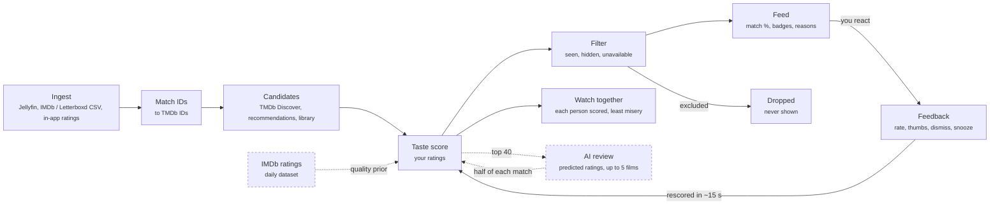

# iWantToWatch — Web App implementation plan

**Goal:** a self-hosted, open-source service that learns your taste from Jellyfin, IMDb/Letterboxd, and Trakt, then suggests unwatched movies you can actually play tonight — on your Jellyfin server or on the streaming subscriptions you have. Web App first; the backend API is designed so the Android and iOS apps reuse it unchanged.

This file is the plan's source of truth: update it in the same commit as the work it describes. Sections 1–8 record the original design; where the code took a different path, the milestones in section 9 say so.

## Pipeline

Suggestions are ranked by your own ratings, and only unwatched films you can play reach the feed. Dashed boxes are optional inputs, skipped when not configured.



- **Ingest:** Jellyfin webhooks plus a 30-minute reconcile poll record plays, favourites, and the library with no manual logging. IMDb and Letterboxd CSV imports add historical ratings, and in-app ratings add a reaction, up to three tags for what you liked or didn't, and an optional note.
- **Match IDs:** every source resolves to one TMDb movie ID. Jellyfin carries provider IDs, IMDb rows map through TMDb `/find`, and Letterboxd rows match on title and year, with a review queue for ambiguous rows.
- **Candidates:** unwatched Jellyfin films, TMDb Discover per subscribed service and region, TMDb recommendations of your top-rated films, and per-language discovery so Malayalam or Korean films aren't crowded out. Films the LLM added at the last build stay among them.
- **Taste score:** a per-user model predicts where each film would land among your own ratings: nearest neighbours blended with a ridge model on cast, crew, keywords, language, and decade, plus a quality prior from IMDb (or TMDb) votes judged within each language. An optional birth year lowers films from before it. With an LLM configured, it then reviews the top 40 (playable ones first) without seeing their match: it predicts the rating you'd give each, from your taste summary and what you said about films, and may add up to 5 films of its own, which are matched to TMDb and scored the same way. Its predicted rating becomes a percentile of your own ratings and makes up half of the match, a weight checked against held-out ratings with `iwanttowatch eval-llm`. Match % is that predicted percentile.
- **Filter:** drops anything watched or rated in any source, dismissed or snoozed, and anything not on the platforms picked with the chips: by default, anything neither on your Jellyfin server nor on a service you subscribe to (or a free one) in your region.
- **Feed:** re-ranked for variety and shown as cards with match %, where to watch, IMDb rating, genre and mood tags, and a reason such as "Like Kumbalangi Nights, which you rated highly" or the AI's own reason.
- **Feedback:** ratings and thumbs become training labels; dismissing or snoozing hides a film. The feed is rescored about 15 seconds after you stop.
- **Watch together:** the same model scores each film for everyone watching; the group order penalises films anyone is likely to dislike.

## 1. Key decisions

| Decision | Choice | Why |
| --- | --- | --- |
| Backend | Python 3.12, FastAPI, SQLAlchemy 2 + Alembic | Best ecosystem for the recommender (numpy, scikit-learn, ONNX embeddings); FastAPI emits OpenAPI, which the web and mobile clients are generated from |
| Database | SQLite (WAL mode) + `sqlite-vec` for embeddings, on a `/data` volume | Zero extra container, tiny idle footprint, easy backups. SQLAlchemy keeps PostgreSQL possible later, but v1 ships SQLite only |
| Background jobs | APScheduler inside the API process | No Redis/Celery/worker container; jobs are small and per-household |
| Embeddings | `fastembed` (ONNX Runtime, no PyTorch) with a multilingual model such as `paraphrase-multilingual-MiniLM-L12-v2` | Runs on CPU on a NAS; multilingual so Malayalam/Tamil/Hindi overviews embed as well as English. Loaded only while a job runs, then released |
| LLM | Optional, behind one `LlmProvider` interface with two backends: **Ollama** (local sidecar, compose profile) or **Google Gemini** (API key). Never required | Used only for explanations, mood tags, and natural-language requests; the core engine works without either. Ollama keeps everything on your server; Gemini needs no local RAM/GPU but sends data to Google, so it is opt-in |
| Frontend | React + TypeScript + Vite, TanStack Query, Tailwind; built to static files served by FastAPI | One container, one port. A PWA manifest makes it installable on phones before native apps exist |
| API client | `openapi-typescript` generated client in `packages/api-client` | Shared later by the mobile apps |
| Canonical movie ID | TMDb movie ID | Jellyfin and Trakt carry it; IMDb IDs map to it through TMDb `/find` |
| Container base | `python:3.12-slim` (Debian), multi-arch amd64 + arm64 | Alpine (musl) lacks prebuilt wheels for numpy/onnxruntime, which makes builds slow and images larger. Debian slim satisfies the requirement |
| Auth | Sign in with Jellyfin credentials (server-side `AuthenticateByName`), plus a local admin account | Household users map 1:1 to Jellyfin users with no extra passwords |

**Target footprint:** under 150 MB RAM and near-zero CPU at idle without Ollama; image under 400 MB including the embedding model.

## 2. Repository layout

```text
iwanttowatch/
  server/                    FastAPI app (package: iwanttowatch, src layout)
    src/iwanttowatch/
      api/                   REST routes under /api/v1
      db.py                  models (split into a package as it grows)
      migrations/            Alembic, applied on startup
      connectors/            jellyfin/, tmdb/, trakt/, watchmode/, imports/ (imdb, letterboxd)
      catalog/               title metadata, ID matching, caching
      recommender/           features, embeddings, models, candidates, ranking, eval
      jobs/                  scheduler + job definitions
    tests/                   pytest; recorded HTTP fixtures (respx)
  web/                       React app
  packages/api-client/       generated TypeScript client
  Dockerfile, docker-compose.yml   at the root, so `docker compose up` works from a clone
  docs/                      this plan, plus setup guides (Jellyfin webhook, TMDb key, imports)
```

The code ended up flatter: one module per concern under `src/iwanttowatch/` (see `AGENTS.md`).

## 3. Data model (SQLite)

| Table | Purpose / key columns |
| --- | --- |
| `users` | id, display\_name, jellyfin\_user\_id, region (e.g. `IN`), preferred\_languages, is\_admin |
| `titles` | tmdb\_id (PK), imdb\_id, title, original\_title, original\_language, spoken\_languages, origin\_countries, year, runtime, genres, keywords, top cast, directors/writers, overview (+ translated overviews), vote stats, popularity, poster\_path, fetched\_at |
| `title_embeddings` | `sqlite-vec` virtual table: tmdb\_id → vector, model\_version |
| `ratings` | user\_id, tmdb\_id, source (`imdb`, `letterboxd`, `trakt`, `app`, `jellyfin`), raw\_value, value\_10 (normalised 0–10), rated\_at. One effective rating per user/title: latest explicit wins |
| `watch_events` | user\_id, tmdb\_id, source, watched\_at, completion\_pct |
| `library_items` | jellyfin\_item\_id, tmdb\_id, library\_id, visible\_to (users), added\_at, removed\_at |
| `availability` | tmdb\_id, region, provider\_id, monetization (`flatrate`, `free`, `ads`, `rent`, `buy`), fetched\_at |
| `providers` / `user_subscriptions` | provider catalogue per region (from TMDb) and each user's active subscriptions |
| `feedback` | user\_id, tmdb\_id, kind (`up`, `down`, `dismiss`, `snooze`, `seen`), created\_at |
| `scores` | user\_id, tmdb\_id, score, match\_pct, reasons (JSON), model\_version, computed\_at — the precomputed feed |
| `import_jobs` / `import_rows` | uploaded CSVs, per-row match status, review queue for ambiguous rows |
| `api_cache` | key (method + normalised URL), body (compressed), etag, fetched\_at, expires\_at |
| `sync_state` / `job_runs` | per-connector cursors, last success/error, durations — shown on a Status page |

## 4. Connectors

### Jellyfin (primary, zero manual logging)

- **Setup:** admin enters server URL and an API key (Dashboard → API Keys). Each person links their Jellyfin user by signing in to Jellyfin once in Settings, or gets an account by signing in to iWantToWatch with Jellyfin credentials.
- **Initial sync:** per user, page through `/Items` with `IncludeItemTypes=Movie`, `Recursive=true`, `Fields=ProviderIds,...` to get the library that user can see plus `UserData` (Played, PlayCount, LastPlayedDate, IsFavorite, PlayedPercentage).
- **Live updates:** the official Webhook plugin with a Generic destination and "Send All Properties" posting to `/api/v1/webhooks/jellyfin?token=…`. A webhook only names the user and item; that item is then re-read from Jellyfin. Item Added/Deleted trigger a full sync.
- **Reconcile poll:** a full library read every 30 minutes and on startup (a few requests per user even for thousands of films), so no incremental cursor is needed. Webhooks are an accelerator; the poll alone guarantees correctness if a webhook is missed.
- **Signals produced:** watched → exclude + weak positive; favourite → strong positive; abandoned under 20% → weak negative; in library → "On Jellyfin" availability.

### TMDb (metadata, candidates, availability)

- Each self-hoster supplies their own free TMDb API key in the setup wizard. Show the required TMDb attribution.
- Details fetched with `append_to_response=credits,keywords,translations,alternative_titles,external_ids` in one call per title.
- **Availability:** `/movie/{id}/watch/providers` per region (data is from JustWatch; **JustWatch attribution is mandatory** or TMDb may revoke the key). Store only `flatrate`/`free`/`ads` for the strict filter; `rent`/`buy` shown as secondary info.
- **Provider list:** load `/watch/providers/movie?watch_region=XX` and let users pick their services. Do not hard-code IDs (e.g. Netflix 8, Prime Video 119, JioHotstar 2336 today), and group "channel" variants (e.g. Prime Video Channels) under their parent.

### Imports: IMDb, Letterboxd, and Netflix

- **IMDb `ratings.csv`:** parse `Const` (tt-ID), `Your Rating`, `Date Rated`; map via TMDb `/find/{imdb_id}?external_source=imdb_id`. Expect \~100% matches. Column names have changed over time, so parse headers by name, tolerate extra columns, and keep a fixture per known variant.
- **Letterboxd export ZIP:** `ratings.csv` (0.5–5 stars → ×2), `watched.csv`, `diary.csv`, `likes/films.csv`. Rows have Name + Year only, so match with TMDb search on title + year (±1), scoring against original and alternative titles; low-confidence rows go to a review queue in the UI.
- **Netflix `NetflixViewingHistory.csv`** (Viewing activity → Download all, one profile): only Title and the last date watched, in the account's locale (12/31/24, 31/12/24, 31.12.24); day-first vs month-first is whichever keeps the file newest first. Episodes ("Dark: Season 1: Secrets", or three or more colon parts) collapse to one skipped row per series; two-part titles TMDb finds no film for but knows as a show ("Our Planet: Jungles") are skipped too. Films match by title, released no later than the year watched, and count as watched with no rating.
- Re-importing is idempotent (upsert on user + title + source).
- **Automated IMDb sync:** IMDb has no public API, so scraping is out of scope. Users who run IMDB-Trakt-Syncer get IMDb data in automatically via the Trakt connector.

### IMDb ratings (optional, public opinion)

- IMDb's non-commercial datasets include `title.ratings.tsv.gz`: every title's weighted rating and vote count, refreshed daily, free for personal and non-commercial use. No API key.
- On the films iWantToWatch knew about on 2026-11-06, IMDb had 52× more votes than TMDb (median 7,912 vs 151), and 158× more for Malayalam films (6,652 vs 42). TMDb's few votes let a few hundred fans rate a film 8.8 that IMDb rates 6.7.
- An admin turns it on in Settings, which notes IMDb's non-commercial terms. Feed builds download the file at most once every 20 hours and copy the rating and vote count of films in the catalogue; turning it off removes them. The UI credits IMDb while it's on.

### Trakt (optional)

- OAuth device-code flow; each self-hoster registers their own Trakt app (Standard API tier is free).
- Pull `/sync/history/movies`, `/sync/ratings/movies`, `/sync/watched/movies`; use `/sync/last_activities` to skip unchanged data. Respect rate limits (authenticated GET: 500 per 5 min) and `Retry-After`.
- **Caveat:** since July 2026, free Trakt accounts can connect only one Community App. Users already using Trakt with another app (e.g. a Jellyfin Trakt plugin) would need VIP, so iWantToWatch also accepts a **Trakt data export** file as a one-time import. Jellyfin stays the primary live source.

### LLM providers (optional): Ollama or Gemini

- **One interface, two backends.** Recommender code calls `LlmProvider.generate(prompt, json_schema)` and never knows which backend answers. Settings sets up Ollama (base URL + model) and Gemini (API key + model), each checked with a test prompt, and puts the ones in use in an order the admin chooses: the first is always asked first, and the next answers when it fails, such as at Gemini's free daily limit or with Ollama switched off. Each attempt is in the LLM log.
- **Gemini:** calls the Gemini REST API with the user's own key from Google AI Studio and requests structured JSON output. The model name is configurable rather than hard-coded, since Google renames models often. Its free tier has rate limits, so calls go through the same rate limiter, backoff, and circuit breaker as other connectors.
- **Privacy:** prompts contain only title metadata and an aggregated taste summary (e.g. top genres, languages, people), never usernames, Jellyfin URLs, or raw watch history. The Settings page states that Gemini sends this data to Google.
- **Cost control:** results are cached in the DB per title and prompt version, so mood tags and explanations are generated once, not on every page view.
- **Embeddings stay local** (`fastembed`) for both choices. Switching to Gemini embeddings would mean re-embedding the whole catalogue in a different vector space, so it is not part of v1.

### Other availability sources (adapters, off by default)

- **Watchmode:** optional adapter behind the same `AvailabilityProvider` interface for users who want a second source; quota-limited free tier, so only refresh titles shown in the feed.
- **JustWatch direct:** no official public API; not shipped. The adapter interface lets the community add one at their own risk.

## 5. Resilience and caching

- One shared HTTP client per connector with: `api_cache` lookups (TTL per endpoint: title details 30 days, credits/keywords 30 days, watch providers 3 days, discover pages 24 h), conditional requests with ETag where supported, a per-host token bucket and concurrency cap, exponential backoff honouring `Retry-After` on 429/5xx, and a circuit breaker that pauses a failing connector.
- On failure the UI serves the last good data and marks it stale; the Status page shows each connector's last success and error.
- Before a title with stale availability (older than its TTL) appears in the feed, it is rechecked in the background; if the check fails it keeps its last known badge with a "checked N days ago" note.
- Posters are lazily cached to `/data/posters` (w342 size, capped disk usage).
- Nightly SQLite online backup to `/data/backups` (keep 7).

## 6. Recommendation engine

### Labels: turning signals into taste

- Normalise every explicit rating to 0–10, then convert to the user's own **percentile** (Criticker-style), so a generous rater and a harsh rater are comparable and "match %" means "predicted to land in your top X%".
- Implicit signals become low-weight pseudo-labels: favourite ≈ 85th percentile, thumbs-up ≈ 80th, completed but unrated ≈ 60th, thumbs-down ≈ 20th, abandoned ≈ 30th. Explicit ratings always override.

### Features per title

- **Multilingual text embedding** of title, original title, overview, tagline, genres, and keywords.
- **Structured sparse features:** genres, TMDb keywords, directors, writers, top-billed cast, composer, original language, origin country, decade, runtime bucket.
- **Weak priors:** Bayesian-averaged vote and log popularity — normalised **within each original language**, so a well-loved Malayalam film with 300 votes is not treated as obscure next to a Hollywood film with 30,000. The vote is IMDb's when IMDb ratings are on, otherwise TMDb's.

### Candidate generation (nightly + on demand)

Union, de-duplicated, minus already-excluded titles, capped at a few thousand per user:

1. Unwatched movies in the user's Jellyfin libraries.
2. TMDb Discover per subscribed provider (`with_watch_providers`, `watch_region`, `with_watch_monetization_types=flatrate`), across the user's languages, sorted by vote average with a per-language vote-count floor. Each search reads pages until it has 40 films the user hasn't seen (up to 10 pages), so a language whose best films they've mostly watched is searched deeper (2026-11-08: on a real feed whose main language the user had mostly watched, playable films in that language went from 5 to 25).
3. TMDb recommendations/similar for the user's top-rated \~50 titles.
4. Per-language discovery for every language that appears in the user's ratings or settings, so regional cinema is always represented.
5. When an LLM is configured: films it suggests from the user's taste summary, including what they liked or disliked about films in their own words.

### Scoring model (v1, per user, CPU-only)

- **Neighbour score:** for each candidate, the similarity-weighted average percentile of the user's k (≈20) most similar rated films in embedding space. Explainable: "because you rated *Kumbalangi Nights* 9 and *Maheshinte Prathikaaram* 8".
- **Feature score:** a ridge regression on the sparse features trained on the user's labels; learns things like "likes Fahadh Faasil and Dileesh Pothan, dislikes slasher horror".
- **Blend:** weights chosen per user by cross-validation; with few ratings (under \~30) the blend leans on language/genre preferences and quality priors (cold start).
- **Match %:** predicted percentile, calibrated on held-out ratings.
- **Retraining:** full rescoring nightly; after feedback, a debounced (\~30 s) background rescore of that user. Both models train in well under a second for thousands of ratings.

### Filtering, ranking, explanations

- **Hard exclusions:** watched or rated in any source, dismissed, or snoozed (until the snooze ends).
- **"Available only" toggle (default on):** keep a title only if it is in a Jellyfin library visible to the user **or** has a `flatrate`/`free`/`ads` offer on one of the user's subscriptions in their region.
- **Diversity:** MMR re-ranking on embeddings, so the top 20 is not ten near-identical films; optional language mix control.
- **Mood tags:** a curated mapping from TMDb keywords to a small mood vocabulary (feel-good, dark, slow-burn, mind-bending, family, thrilling…); the configured LLM (Ollama or Gemini) can refine tags when enabled.
- **Evaluation:** `iwanttowatch eval` holds out 20% of a user's ratings and reports Spearman correlation and NDCG@20 against a popularity baseline, so contributors can compare models objectively.

### Later model upgrades (not v1)

- Household collaborative filtering once several users have ratings.
- Optional user-downloaded MovieLens data for item-item CF (its licence forbids redistributing it, so it cannot ship in the image).
- LLM re-ranking of the top 100 with the configured LLM (Ollama or Gemini), for natural-language requests like "something light and Malayalam tonight".

## 7. Web App

| Screen | Contents |
| --- | --- |
| Setup wizard (first run) | TMDb key, Jellyfin URL + API key, default region, admin account; tests each connection |
| Discovery feed | Cards: poster, title + original title, year, language, **match %**, availability badges (On Jellyfin, On Netflix, On Prime Video, On JioHotstar), genre and mood tags, one-line reason. Actions: 👍 👎 rate (1–10) · dismiss · seen it. Filters: available-only toggle, providers, languages, genres, runtime, decade |
| Title detail | Overview, cast/crew, where to watch (with JustWatch attribution), "Play on Jellyfin" deep link, why it was suggested |
| My taste | Rating history by source, imports, review queue for unmatched rows, top genres/languages/people learned |
| Settings | Region, subscriptions, languages, connectors (Jellyfin, Trakt, Watchmode), LLM provider (None / Ollama / Gemini), data export |
| Status | Connector health, last sync, job history, cache stats |

**API (REST, `/api/v1`):** `auth/*`, `me`, `settings`, `imports` (upload, status, review), `ratings`, `feed` (paginated, filter params), `titles/{tmdb_id}`, `feedback`, `connectors/*`, `webhooks/jellyfin`, `status`. The feed reads from the precomputed `scores` table, so it stays fast on slow hardware.

## 8. Deployment

- One image, `iwanttowatch`, built in two stages: Node builds `web/`, then a `python:3.12-slim` runtime with the static files and the embedding model baked in. Runs a single uvicorn worker as a non-root user, with a `/healthz` healthcheck.
- `docker-compose.yml`: the `iwanttowatch` service with a `./data:/data` volume and port 8080; an `ollama` service behind a `llm` profile.
- Configuration: a few env vars (`IWANTTOWATCH_SECRET_KEY`, `IWANTTOWATCH_BASE_URL`); everything else via the setup wizard, stored in the DB with secrets encrypted by the secret key.
- Publish multi-arch images (amd64, arm64) on each tagged release.

## 9. Milestones

Each phase ends in something runnable in Docker.

### Phase 0 — Foundations

- [x] Monorepo scaffold, AGPL-3.0-or-later licence, trademark policy, contributing guide, CI (ruff, mypy, pytest, oxlint, tsc, API-client drift check, Docker build)
- [x] FastAPI skeleton, SQLite + Alembic, settings, local admin auth, setup wizard (admin account, region, languages)
- [x] React shell, generated API client, Dockerfile + compose

**Exit:** `docker compose up` serves the wizard; idle RAM measured and recorded. **Met** 2026-11-05: container healthy, about 59 MiB RAM and 0.2% CPU at idle, 245 MB image.

### Phase 1 — Catalog and taste import

- [x] TMDb client with cache, rate limiter, backoff
- [x] Title model + metadata fetch, multilingual fields
- [x] IMDb and Letterboxd import, matching, review queue, My taste page

Built and tested against a fake TMDb on 2026-11-06. The exit criterion still needs a real TMDb key and real exports.

**Exit:** a real IMDb export of 1,000+ ratings imports with ≥ 99% auto-matched; a Letterboxd export with ≥ 95% auto-matched.

### Phase 2 — Jellyfin

- [x] Connector, user linking, Jellyfin login
- [x] Library + watched/favourite sync, webhook endpoint, reconcile poll; sync status shown in Settings instead of a separate Status page

**Exit:** finishing a movie in Jellyfin marks it watched within a minute with the webhook, or within 30 minutes without it. **Met** 2026-11-06: against a real Jellyfin 12.4 with Webhook plugin v22, a playback stop showed as watched in 0.25 s; with the webhook failing, the next full sync caught up.

### Phase 3 — Availability

- [x] Provider catalogue per region, subscription settings (per person: country and services)
- [x] Per-title availability cache (3 days, last good data kept and marked stale on failure), badges on My taste, JustWatch attribution. Rechecks happen when titles are shown; Phase 4 adds the background refresh for feed candidates.
- [x] Other ways to watch (2026-11-09): a film's details also list what the user can't play now, as `other_offers`: services they don't pay for, and renting or buying. So a film shown with "Include unavailable" no longer reads "Not on your Jellyfin server or your streaming services" with nothing beneath it. Feed and search lists omit them to stay light
- [x] Rent and buy sections collapsed by default (2026-11-09): Rent and Buy in a film's details are kept behind an expandable button by default, with a user setting in Settings → Your streaming services to show them expanded by default

Built and tested against a fake TMDb on 2026-11-06; channel variants are listed separately rather than grouped. The exit criterion still needs a real TMDb key.

**Exit:** badges for a sample of 50 titles in region IN match TMDb's watch pages.

### Phase 4 — Recommender v1 and Discovery feed

- [x] Features (TF-IDF over genres, keywords, people, language, decade), candidate generation, neighbour + ridge models with a per-language quality prior, cross-validated blend and calibration. Embeddings are deferred: the neighbour model uses the sparse features for now, which keeps the image small
- [x] Filters (available only, language, genre), MMR, reasons, mood tags; feed and title detail UI with "Play on Jellyfin" and rate-from-detail
- [x] `iwanttowatch eval <username>`: Spearman and NDCG@20 against a popularity baseline
- [x] Faster page loads (2026-11-06): gzip for text responses, hashed assets cached for good, and the page preloads the setup and account requests alongside the script. At 250 ms latency the feed data arrives at 0.90 s instead of 1.48 s

Built and tested against a fake TMDb on 2026-11-06. The exit criterion still needs real ratings, a real TMDb key, and a Pi-class machine.

**Exit:** beats the popularity baseline on held-out ratings (NDCG@20); feed loads in under 300 ms on a Raspberry Pi 5–class machine.

### Phase 5 — Feedback loop

- [x] Netflix-style rating (Didn't like / Liked / Loved) with up to 3 tags from a fixed vocabulary — "what did you like most?" or "what didn't work?" — fed into the taste summary and persona; reactions map to the user's own 15th/65th/90th rating percentiles (pulled forward, 2026-11-06)
- [x] Rating tags in a fixed core row, the same for every film and in the same order, then three suggested for the film's genres and keywords and the rest behind "More"; an optional 200-character note per rating, quoted in the taste summary the AI sees (2026-11-08)
- [x] Thumbs, dismiss, snooze (30 days), seen-it with undo on feed cards. Thumbs are weak labels at the 80th/20th percentile; thumbs-down, dismiss and snooze hide the film; seen-it records a watch, and the undo toast also offers "Rate it"
- [x] Debounced incremental rescoring: 15 s after the last rating or feedback, the stored candidates are scored again without TMDb requests; the feed shows "Re-ranking with your feedback…" and refreshes itself
- [x] Optional birth year in Settings: films from before it lose up to 15 points of match, growing over the 20 years before the birth year, applied after the AI's share. Liked films from before the birth year halve it after 3, but only for films within 10 years of them, so liking films from a few years before you were born doesn't rescue films from thirty years before (revised 2026-11-08). Never a filter; kept out of AI prompts and taste links; used per person in Watch together (added 2026-11-06)
- [x] Quality prior fix: a language with few films in the pool borrows the vote norms of all films, so a film alone in its language isn't judged against itself (2026-11-06)
- [x] IMDb ratings for quality (2026-11-06): an admin switch in Settings; the quality prior uses IMDb's rating and votes when known, and cards and title details show "IMDb 8.7". On a real feed, Facing El Chapo (TMDb 8.8 from 975 votes, IMDb 6.7 from 9,925) fell from 85% to 59%
- [x] AI picks (2026-11-06): with an LLM configured, each feed build asks it for 25 films from the taste summary, including what the user liked or disliked about films. They're matched to TMDb, scored by the same recommender with a 4-point bonus, filtered for seen films and availability like any candidate, and marked "AI pick: …" with the LLM's reason. A failed LLM call keeps the last build's picks
- [x] AI review replaces AI picks (2026-11-08): the feed shows the recommender's order at once, then the LLM predicts the user's rating for the top 40 films (playable first, without their match) and adds up to 5 of its own. Each prediction becomes a percentile of the user's ratings and makes up half of the match (chosen on two held-out samples: average Spearman 0.56 against 0.46 for the recommender alone); cards show "AI, expects 8/10: …". Rescoring reuses the stored predictions. `iwanttowatch eval-llm <user>` hides 30 ratings from both and compares: on two samples (Gemini Flash), average Spearman 0.46 for the recommender, 0.54 for the LLM, 0.50 at a quarter, 0.56 at half, and 0.57 at three quarters, which was the worst blend on one sample

**Exit:** a thumbs-down visibly reorders the feed within a minute. **Met** 2026-11-06 against a fake TMDb: a thumbs-down on a Nolan film re-ranked the feed about 16 s later, and the other Nolan film dropped the most.

### Phase 5b — Watch together (group picks)

Proposed 2026-11-06: "what should we all watch next" when friends come over.

- [x] Pick who's watching on a new Watch together page: the household is every user on this server, plus guest profiles from friends on other iWantToWatch servers; a one-tap "Household" chip selects everyone at home
- [x] Shareable taste profile: a revocable link (Watch together → Share your taste) serving only TMDb IDs, how much the person liked each, and which films they've seen; no names or server details. The host refreshes a guest's copy when it's over an hour old and drops the guest when the link is revoked
- [x] Group score: each film scored for each person by the same recommender. Ordering uses the average minus a penalty when anyone falls below 60% (least misery); the card badge shows the plain average
- [x] Exclude films anyone has seen or hidden; availability is the host's Jellyfin and services
- [x] Group cards with each person's match (red below 60%) and each reason labelled with whose taste it comes from
- [x] Taste card file for friends whose server can't be reached from yours (most home servers): the same data as the link, downloaded from Share your taste and sent by any messenger, then uploaded under "Add a friend". It doesn't refresh itself and can't be revoked once sent; the friend's chip reads "card" (2026-11-06)

Built and tested with two instances against a fake TMDb on 2026-11-06. The exit criterion still needs real rating depth: someone with only a few ratings stays near the cold-start baseline, below 60% for most films.

**Exit:** for a group of three, every pick in the top 10 is at least a 60% match for each person.

### Phase 5c — Child profiles

Proposed 2026-11-06: parents find what their kids should watch.

- [x] Household-level child profiles: created and managed by any adult in the household (`User.is_child = True`, no password), inheriting household Jellyfin libraries (`library_owners`). Any adult can switch to any child profile or back to their adult profile from the header profile dropdown without a PIN (revised 2026-11-08)
- [x] Birth-year age limit with removable Discover filter: each child profile sets a `birth_year`, which derives the child's age and `max_certificate` / `allowed_certificates` for the country from TMDb's per-country certifications. Only the Discover tab filters by the child's age limit (`age_limit=True` by default), and the restriction filter can be removed on the Discover page (`age_limit=False`) without rebuilding the feed. Child profiles can search, view details, shortlist, and rate any film in their library without certificate blocks (revised 2026-11-08)
- [x] Adult movie assignment to child profiles: any adult can assign or unassign a film to any child's shortlist from the button below each movie card on Discover and Watch together or inside the title dialog (`PUT/DELETE /api/v1/children/{child_id}/shortlist/{tmdb_id}`); assigned films are always visible in the child's Discover feed even when the age filter is active (2026-11-08)
- [x] Family-positive signals: TMDb keywords such as friendship, courage, and kindness; parents' "Great with family" tags; the child's own reactions
- [x] Optional LLM-written bullet-point-driven "themes and values" note per film (covering values in 3–4 keywords, remake status under 15 words, and famous other films by director/writer under 20 words), labelled as AI-written (no free API rates morals: Common Sense Media and IMDb's parents' guide have no open API)
- [x] Child profiles take part in household and Watch together picks, with the age limit applied to the whole group

**Exit:** no film above a child's certificate ever appears in their feed (while the age restriction filter is on) or in a group pick that includes them. **Met** 2026-11-07 against a fake TMDb and revised 2026-11-08 for household-level child profiles with birth-year limits, header profile switching, adult film assignment, and a removable Discover-only age restriction filter.

### Phase 5d — Shortlists, Discover controls, and dropdown filters

Proposed 2026-11-08 from the ideas review: decide faster between films you'd watch.

- [x] Personal shortlist and hide-shortlisted filter: a bookmark on each card and in the title dialog saves a film; the Shortlist dropdown in Discover's filter row switches between all films, shortlist only (`shortlist=true`), and hiding already-shortlisted films (`hide_shortlisted=true`) so you can browse fresh picks without films you've already set aside. Saved films stay feed candidates so they keep a match, override an earlier "not interested", drop off once watched or rated, and are exported and restored (2026-11-08)
- [x] Discover ordering: an Order by dropdown on Discover sorts the filtered feed by recommended (default feed diversity order `recommended`), highest match (`match`), highest rating (`rating`, IMDb when enabled or TMDb), newest first (`newest`), oldest first (`oldest`), or shortest runtime first (`shortest`) (2026-11-08, recommended and highest match split 2026-11-10)
- [x] Group shortlist on Watch together: one list for everyone on the server. A bookmark on each group card saves a film and shows "Added by …"; the Group shortlist dropdown next to the platform filter shows only saved films, scored for whoever is watching. Saved films join the group's candidates even when out of every feed, override an earlier "not interested", and drop out once anyone watching has seen them (2026-11-08)
- [x] Guest voting link: on Watch together the host starts a guest vote for the people at home; guests open the link or QR code on their phone, enter a first name, and mark each film Yes, Maybe, No, or Seen it, with no account. The ballot is up to 24 group picks the host can play, the group shortlist first; guests can add up to 12 more from a search limited to the host's Jellyfin and services and any child's age limit. The host's live tally averages the votes (yes 100%, maybe 50%, no 0%) with the household's match as one more voter, and puts films a guest has seen last. Guests see only posters, titles, and where films stream. The guest pages are the only ones without sign-in: one unguessable token per vote, rate-limited per address, ending after 24 hours or when the host closes it, which deletes guests' names and votes (2026-11-08)
- [x] Dropdown filters with stacked icons across pages: all page filters use compact dropdowns — Where to watch (`PlatformFilter`) on Discover and Watch together shows stacked service/Jellyfin icons (`-space-x-1.5`) for the active platforms, Who's watching on Watch together uses a dropdown with stacked initial badges for selected watchers, and Shortlist, Language, Genre, Decade, Age rating (`max_certificate`, cumulative "Rated PG-13 & under" in the user's region scale for adults), Order by, and Age restriction on Discover are dropdowns (2026-11-08, adult certificate filter added 2026-11-09, decade filter added 2026-11-11)

**Exit:** a household builds a shortlist together and filters it to one platform before choosing.

### Phase 5e — Radarr integration (download & acquisition)

Proposed 2026-11-09: bridge recommendation discovery and media acquisition for films not playable on the user's streaming platforms or Jellyfin.

- [x] **Phase 1 — Radarr connector & manual trigger:** Connect to Radarr with URL and API key in Settings; fetch quality profiles and root folders with test connection; support language-specific root folder routing (e.g. Malayalam, Tamil, Hindi, English) with auto-detection from folder names; view Radarr status (downloading, monitored, downloaded) and trigger on-demand downloads ("Download via Radarr") directly from the title details dialog for unstreamable films (2026-11-09)
- [x] **Phase 2 — Shortlist sync & trigger:** Automatic or one-click batch request to Radarr for shortlisted titles not available on current streaming platforms or Jellyfin; toggle auto-sync in Settings to instantly queue new unstreamable shortlisted films, or trigger one-click batch downloads from Discover (personal shortlist) and Watch together (group shortlist) (2026-11-10)
- [ ] **Phase 3 — Background auto-downloader:** Autonomous downloader for top recommendations scoring $\ge 85\%$ match that are not available on any streaming platform or Jellyfin, safeguarded by strict controls (weekly download caps, minimum vote floors, and physical/digital release availability filters).

### Phase 5f — Smart Media Lifecycle: Acquisition Radar & Declutter Assistant

Proposed 2026-11-10: balance smart media acquisition and library decluttering using taste models, streaming availability, and multi-user household awareness.

- [x] **Acquisition Radar & Theatrical Tracking:**
  - High-value "Missing from Streaming" acquisition queue: unwatched high-match recommendations not available on any subscribed streaming platform or Jellyfin.
  - "Now in Theaters" early tracking: discover high-taste theatrical releases using TMDb's theatrical discovery (`with_release_type=2|3`, `now_playing`) and queue them in Radarr monitored with `minimumAvailability="released"` so digital/physical releases are acquired automatically without pulling CAM/telesync rips.
  - Dedicated "Acquisition Radar" view in Server Settings with tabbed queues, match percentage thresholds, batch queuing, and direct Radarr integration (2026-11-10).
- [x] **Library Declutter Assistant:**
  - Taste-driven prune candidate detection across Jellyfin & Radarr:
    - **Watched & Disliked:** user or household member rated $\le 4.0/10$, reacted "disliked", or marked thumbs down.
    - **Abandoned Play:** playback stopped at $< 20\%$ completion and abandoned for $> 30$ days.
    - **Cold Hoard / Low Taste Match:** unwatched on disk for $> 6$ months with predicted taste match $< 35\%$.
    - **Streaming Redundancy:** watched title currently available on user's active flatrate/free streaming subscriptions (e.g. Netflix, Prime Video), making local disk retention redundant.
    - **Unplayable in Jellyfin:** downloaded in Radarr with non-zero disk occupied (`sizeOnDisk > 0`), but missing from Jellyfin library (unindexed, unsupported container/codec, or non-playable media file) (2026-11-10).
  - **Household Protection Guardrails:** automatically protects films from pruning suggestions if any other household member has shortlisted, favorited, rated $\ge 7.0$, or has a high unwatched taste match ($\ge 70\%$).
  - **Storage Reclaim Metrics & Safety Controls:** reads file sizes directly from Radarr (`sizeOnDisk`), displays total gigabytes reclaimable, category breakdowns, and provides one-click or batch deletion via Radarr API (`DELETE /api/v3/movie/{id}?deleteFiles=true`) with ignore/keep whitelist actions and confirmation modals.
  - **Web UI:** Dedicated "Declutter Assistant" section in Server Settings (admin-only) with category filters, reclaimed space gauges, safety badges, and bulk actions (2026-11-10).

### Phase 5g — People: Cast & Director Affinity, Filmography, and Favourites

Proposed 2026-11-10: make cast and crew interactive with personal affinity scores derived from past ratings, filmographies with streaming availability, and explicit favoriting that powers candidate discovery and recommendations.

- [x] **Phase 1 — Interactive People & Person Dialog:**
  - Expose person IDs in title credits (`PersonRef` with `id` and `name` for `directors` and `cast` in `TitleDetail`).
  - Interactive director and cast pills/chips in `TitleDialog` opening a `PersonDialog` modal with back navigation to keep browsing state intact.
  - Person details API (`GET /api/v1/people/{id}`): TMDb `/person/{id}` profile (name, bio, photo, known for) and `/person/{id}/movie_credits` cached in `api_cache`.
  - User affinity stats: calculate user's past ratings/reactions on films featuring this person (rated count, average score, Loved/Liked/Disliked breakdown, films seen with user ratings).
  - Filmography list in `PersonDialog`: scrollable lists with independent tabs for "Available to watch" vs "All filmography", with user watch/rating status and quick title detail popups (2026-11-10).
- [x] **Phase 2 — Person Favourites & Recommender Discovery:**
  - `FavoritePerson` model (`user_id`, `person_id`, `name`, `role`, `profile_path`, `created_at`) with `PUT/DELETE /api/v1/people/{id}/favorite` endpoints.
  - Interactive Favorite (❤️) button in `PersonDialog`.
  - Recommender candidate discovery: include favorited people in candidate generation (`with_people={id}`).
  - Feed reasons: surface explicit favorite signals (e.g. "Directed by your favourite Christopher Nolan") (2026-11-10).
- [x] **Phase 3 — My Taste: People Section:**
  - Dedicated "Directors & Cast" tab in `Taste.tsx` displaying favorited directors and actors, alongside top-rated directors (minimum 2 films rated) and actors (minimum 3 films rated) learned from ratings history (2026-11-10).

### Phase 6 — Optional integrations and polish

- [ ] Trakt (device flow, history/ratings pull, export-file import)
- [ ] Watchmode adapter
- [ ] Critic scores (Rotten Tomatoes, Metacritic) through OMDb with a free key; thin coverage of Indian films
- [x] LLM provider interface with Ollama and Gemini backends, tested from Settings (pulled forward, 2026-11-06)
- [x] LLM order: both providers can be set up at once, the admin orders them in Settings, and the next one answers when the first fails; turning one off keeps its settings (2026-11-08)
- [x] "Your taste in brief" per user, rewritten after each import (pulled forward, 2026-11-06; plain words instead of an imaginary person, and genre averages only from genres with 10% of the ratings, 2026-11-08)
- [x] LLM mood tags and explanations: the AI review also picks each reviewed film's moods from the fixed vocabulary, and one more call per feed build tags up to 60 untagged films near the top (films only, no user data); moods are kept per film, so each is tagged once, and keyword moods remain the fallback. A "Why this?" button in the title dialog asks how a film the AI hasn't reviewed fits the user's taste, once per user and film (2026-11-08)
- [x] Unified color-coded IMDb rating badge alongside match percentage: Option A styling everywhere — Discover cards, Watch together cards, and TitleDialog popup pair a circular radial match gauge with a dark glassmorphic IMDb pill badge (yellow tag + color-coded rating score in emerald/accent/muted); popup includes vote count and external link (2026-11-09)
- [x] Natural-language requests: an "Ask" box on Discover sends a request such as "a light Malayalam comedy under 2 hours" and the top 150 films of the filtered feed (year, language, length, genres, moods, director, two stars; no taste data) to the AI, which picks up to 12 that clearly fit, with a sentence each. The feed then shows just those, in match order, with the same filters and card actions, until "Back to the full feed" (2026-11-08)
- [x] LLM call log for admins: every call with its purpose, user, model, duration, prompt, and reply, plus counts for the last hour and day, in Settings → AI activity (paginated at 10 per page, max 24 hours kept; 2026-11-09)
- [x] Netflix viewing-activity CSV import (title and date only, matched like Letterboxd); Netflix has no API, and Prime Video and JioHotstar have no export, so Trakt covers those indirectly. Series are skipped, films count as watched, and an ambiguous title goes to the review queue (2026-11-08)
- [x] Household invite links: an admin creates a one-time link in Settings → Household, optionally naming who it's for; it works once, for a week, and can be copied again or revoked until used. The new member picks a name, username, and password, starts with the admin's region and languages, and is signed in. Jellyfin sign-in stays as it is (2026-11-08)
- [ ] Google sign-in, optional, for admins who set up their own OAuth client (Netflix offers no sign-in for other apps)
- [x] Read-only MCP server for debugging at `/mcp`, protected by a key an admin creates, replaces, or turns off in Settings → Debugging (only its hash is stored). Tools: server status, users, a user's feed with why films are hidden, everything about one film for one user, title lookup, and the LLM log. Speaks MCP's tools-only subset over Streamable HTTP with plain JSON replies, so it adds no dependency (2026-11-08)
- [x] Per-user data export and restore (JSON with profile, ratings and watches per source, and feedback), in Settings → Your data (pulled forward, 2026-11-06)
- [x] Installable web app: a manifest with standard and maskable icons, plus an Apple touch icon, so Chrome, Edge, and Safari offer "Install" or "Add to Home Screen" and it opens full-screen. No service worker: current browsers install without one, and it can't serve a stale app after an upgrade. Installing needs HTTPS, as from a reverse proxy, except on iOS (2026-11-08)
- [x] Server backups: SQLite's backup API copies the whole database every day and before each upgrade's migrations, into `backups/` in the data folder or `IWANTTOWATCH_BACKUP_DIR`, keeping the newest 7. Admins see them in Settings → Server backups, back up on demand, and download a copy; restoring is manual (2026-11-08)
- [x] Film search: a search button in the header finds any film and opens its details with a match scored on request against the feed's own films, so it means the same as on Discover, without adding the film to the feed. Films the user has seen show their rating instead (2026-11-08)
- [x] The running version in the footer, from `pyproject.toml`, linking to the releases (2026-11-08)
- [x] Reaction scores follow the user's current scale: a reaction's 0–10 score is re-derived from their imported ratings after every reaction, import, and restore, so reactions given before an import aren't stuck on the default 3/8/9.5. The recommender places a reaction like an imported rating with the same score but leaves it out of the pool, so films sharing a reaction don't pile up as ties; the AI's predicted ratings are read against the same pool (2026-11-08)
- [x] Targeted candidate discovery on refresh: when filtering Discover by language and/or genre with fewer than 25 matching films, clicking Refresh specifically searches TMDb discover for unwatched movies matching those filters, while preserving existing recommendations (2026-11-09)
- [x] Unified "Why it suits you" section in title dialog: combines algorithmic reasons and AI explanation into a single card; prompts the LLM with runtime, moods, and recommender match reasons with strict anti-repetition instructions for a non-redundant, grounded Hook + Caveat critique (2026-11-09)
- [x] Single AI call for fit, themes, remake, and director's famous films: unified prompt populates both the personal critique and themes note in one call; "Other famous films" render as interactive clickable links that open directly in TitleDialog with back navigation (2026-11-09)
- [x] Deduplicate mood tags and genre chips: suppress redundant genre tags when matching mood tags are displayed (e.g. Thrilling vs Thriller, Scary vs Horror, Funny vs Comedy), and instruct the LLM to pick moods that convey nuances beyond the obvious genre (2026-11-09)
- [x] Divergent opinions / "Against the grain": identifies films the user rated where their score strongly conflicted with general audience consensus (TMDb / IMDb average by at least 1.5 stars). AI analyzes why the user disagreed, synthesizing the public appeal, the specific clash with the user's tags and sensibilities, and why it fits their taste profile. Integrated in the Taste page ("Against the grain" view) and Title dialog ("Conflicting opinion") (2026-11-10)
- [x] Exclude documentaries from feed recommendations: discover queries pass `without_genres=99` to TMDb and candidate filtering, rescoring, and feed endpoints filter out films with the Documentary genre (such as *David Attenborough: A Life on Our Planet*) so discovery stays focused on narrative feature films (2026-11-10)
- [x] Unified header Search and Ask AI box: combines film search and natural-language AI requests into a single persistent search box in the header with segmented toggle buttons (Search and Ask AI). Defaults to film search; toggling to Ask AI sends requests to Discover's AI feed filter from any page with responsive popover search results (2026-11-10)
- [x] Radarr-style Settings revamp: redesigned Settings into a responsive sidebar layout separating Personal settings (My Profile, Import & Export, Streaming Services, Household) from Server Admin settings (Integrations, AI & LLM, Declutter, System), with live-status sub-menus for Integrations (TMDb, Jellyfin, Radarr, IMDb) and direct-anchor smooth scroll navigation across all settings cards (2026-11-10)
- [x] On-demand IMDb rating lookup for searched and newly viewed titles: titles fetched outside feed builds (e.g. via header search or recommendations popup) look up their rating and votes in the local IMDb dataset on demand when IMDb ratings are enabled, storing them on the title row (2026-11-10)
- [x] Poster rating glass capsule and Jellyfin brand badge: moves the reaction buttons (Didn't like, Liked, Loved) to a floating frosted glass capsule docked on the bottom-left of the movie poster in Discover, replaces the double-thumb icon with a heart icon for Loved, right-aligns secondary card actions below the poster, and replaces text Jellyfin badges with the official gradient Jellyfin crystal logo across cards, filters, and dialogs (2026-11-10)
- [x] Standardize ratings around 3-point reaction scale: imports (IMDb, Letterboxd) convert 10-point ratings into Didn't like / Liked / Loved (>=9.0 loved, 6.0-8.5 liked, <=5.5 disliked) while preserving raw rating in the database. Recommender trains directly on discrete reaction percentiles (loved: 0.95, liked: 0.70, disliked: 0.15), eliminating percentile collisions where liked and loved collapsed to 10.0, and Title dialog displays semantic reactions for conflicting opinions (2026-11-10)
- [x] Content type filtering & "Movies only" default: Discover feed defaults to "Movies only", strictly excluding stand-up comedy specials, concert films, behind-the-scenes featurettes, sports broadcasts, and short films (< 40 min). Discover filter bar adds a Type selector (Movies only, Stand-up comedy, Concerts & Live, All content) with targeted TMDb discover, and Profile Settings allows setting the user's default content category (2026-11-10)
- [x] Rich filtering and sorting on My Taste page: filter rated films by title search, reaction (Loved, Liked, Didn't like), language, genre, director / lead actor, reaction tags ("What stood out"), decade/era, watch availability (in Jellyfin, streamable), and personal notes; sort by recently rated, loved first, release year newest/oldest, and title A–Z; cards display personal notes (2026-11-10)
- [x] Segmented capsule navigation and streamlined header on Taste page: replaces the plain text section tabs with a modern segmented capsule tab bar for "Your ratings", "Against the grain", and "Directors & Cast" with high-contrast active styling and embedded badges, and removes the redundant "My taste" header text and "Import ratings" button (2026-11-10)
- [x] Standardize personal ratings display on 3-scale reaction style: replaced lingering numeric ratings (such as `★ 8.0` in PersonDialog's All Filmography & Available to Watch tabs, numeric average score in Taste Affinity, `★ {dir.average_rating}` in Top Directors and Lead Cast, `rated X/10` in TitleDialog seen banner, and raw scores in Divergent ratings) with a consistent `ReactionBadge` (Loved / Liked / Didn't like with matching reaction icons, labels, and color-coded pills), ensuring personal ratings across the app strictly follow the 3-scale reaction system (2026-11-10)
- [x] Unified movie details popup everywhere: standardized movie click behavior across Discover, My Taste (ratings grid, divergent section, film search, and undo toast), and Declutter Assistant so clicking any movie poster or title opens TitleDialog (with full metadata, ratings editor, streaming offers, and Jellyfin/Radarr status) rather than disparate or missing popups (2026-11-10)
- [x] Standardize segmented capsule tabs style across top menus and sub-navigation: unified tab presentation across primary header navigation (Discover, Watch together, My taste, Settings), PersonDialog filmography tabs (Available to watch, All filmography), Acquisition Radar (Missing from Streaming, Now in Theaters), and mobile Settings rail using reusable SegmentedCapsule and shared styling utilities, with Declutter Assistant refactored to an ergonomic category filter dropdown (2026-11-10)
- [x] Declutter Assistant low-quality detection, 0B exclusion, and Whitelist filtering: strictly excludes ghost/deleted movies with 0B size on disk or missing files, adds automated detection and category filtering for low quality releases (CAM/telesync prints and sub-720p resolutions like 480p/DVD) using Radarr metadata, and promotes Whitelisted/Kept movies into both the Category filter and a dedicated Whitelist status dropdown (2026-11-10)
- [x] Declutter Assistant Jellyfin matching & self-healing: prevents false-positive "Unplayable in Jellyfin" candidates for films present and playable in Jellyfin (such as *Enola Holmes*) by extracting clean media titles and release years across scene tags, bracketed years, and dot-separated filenames, matching against Radarr movies and TMDb alternative titles, self-healing unmatched Jellyfin `LibraryItem.tmdb_id` links in SQLite, and fixing Jellyfin sync to retry matching previously unresolved items without freezing them as None (2026-11-10)
- [x] Declutter Assistant combinable multi-category filters: supports multi-category candidate matching on backend returning all qualifying categories per movie, enables combining filters (e.g. Low Quality + Low Taste Match) with configurable ALL (AND) and ANY (OR) combination modes, renders multi-select category chips with counts and mode toggle in DeclutterSettings, and displays all matching category badges on candidate cards (2026-11-10)
- [x] Review Outliers and match percentages on My Taste page: computes leave-one-out out-of-fold recommender match percentages for all rated films and displays them on movie cards; introduces the "Review Outliers" calibration assistant with a luminous animated beacon button for high-residual ratings to re-confirm ratings, verify rewatchability for Loved titles, and capture liked/disliked tags for unexpected ratings; reviews the top 15 outliers per batch while surfacing total unreviewed count on the badge; provides a "Clear rating, keep as watched" action for unremembered or stale titles to prevent recommender distortion; freezes active session items during tag updates, persists user confirmations in `outlier_reviews` so confirmed films permanently leave the queue, and assigns double-confirmed dislikes an elevated 1.5x weight in recommender modeling (2026-11-10)
- [x] Expanded rating tags vocabulary and mixed sentiment support: expanded the fixed tag vocabulary with 8 new craft, tone, and character tags (stunning cinematography, great pacing, original concept, great chemistry, atmospheric, cozy & comfort watch, dark & intense, highly rewatchable) and 8 new critique tags (pacing issues / drags, flat characters, plot holes / illogical, awkward dialogue, poor CGI / effects, wasted potential, boring, inconsistent tone); loosened backend polarity validation to support mixed positive and negative tags (e.g. loved a film despite slow pacing, or disliked a film despite great visuals); added a dedicated, non-intrusive caveats section to RateDialog allowing up to 3 highlights and 2 caveats (up to 5 tags total); and styled caveat tags with distinct warm amber badge styling in Taste lists (2026-11-10)
- [x] Enhanced "How it fits you" section with balanced pros/cons critique: replaces sycophantic prose with dynamic `+` and `-` bullet points (max 4, adaptive ratio) in plain everyday English without critic jargon; formats runtime in hours and minutes (`2h 15m`) and eliminates reflexive runtime complaints; updates title dialog heading to "How it fits you" and action buttons to "How does it fit? Ask AI" and "Re-evaluate with AI" (2026-11-11)
- [x] Actor and person search in unified Search bar: extends header search with a concurrent TMDb `/search/person` lookup alongside movie title matching; displays matched actors, directors, and crew with profile avatars and roles in a dedicated "Actors & Crew" row; integrates top known films directly into the "Films" results; and links actor chips directly to PersonDialog for full biography, taste affinity, streaming availability, and filmography browsing (2026-11-11)
- [x] Redesigned TitleDialog popup: introduced a sticky top header keeping English title, metadata, IMDb badge, action toolbar (Shortlist, Assign to child, Close), pure-icon streaming network dock (capped at 4 with overflow pill), and color-coded rating controls (Watched, Didn't like, Liked, Loved) anchored right below the streaming dock; collapsed ratings to a single color-coded pill with tap-to-expand; split positive and negative tags into a clean "− The Bad" & "+ The Good" split card showing top tags with an expand toggle for the full vocabulary; collapsible "Where to watch" section kept collapsed by default with auto-expand and scroll from the header streaming dock; and added dedicated "Watched" reaction support across backend and frontend (2026-11-11)
- [x] Dedicated monochrome micro-icons for all reaction tags: introduced 53 crisp Lucide-style vector SVG micro-icons (33 positive highlights, 20 negative critiques) in TagIcon.tsx mapped to every reaction tag in the fixed vocabulary; applied micro-icons across RateDialog's SentimentTagsCard ("− The Bad" & "+ The Good"), quick rate TagChips, My Taste ratings grid and divergent list items, and OutlierReviewDialog to foster muscle memory and instant scanning without visual clutter (2026-11-11)
- [ ] Optional / skipped — TMDb or IMDb IDs in LLM prompts: evaluated 2026-11-08 and left out. LLMs identify films from natural-language metadata (`Title / Original Title (Year, language, director)`) rather than arbitrary numeric TMDb IDs or `tt` IMDb IDs, which add token overhead and hallucinated IDs; candidate prompts (`review_films`, `films_for_request`, `tag_moods`) already map short 1..N indices back to `tmdb_id` in Python, and free-form LLM additions resolve through `find_by_title(tmdb, title, year)`
- [ ] UI translations, docs

### Phase 7 — v0.1 release

- [x] Multi-arch images: each push to `main` that passes CI publishes `ghcr.io/sinoop/iwanttowatch` for amd64 and arm64 (`latest` and the commit SHA). The web app is built on the runner's own platform and only the Python stage runs under QEMU. The compose file pulls the image and can still build from the checkout, so updating a Pi is `docker compose pull && docker compose up -d` (pulled forward, 2026-11-08)
- [x] Install docs with screenshots (`docs/install.md`), release notes (`CHANGELOG.md`), and version tags: each merge to `main` automatically increments the patch version (unless `server/pyproject.toml` was bumped higher), creates a `vX.Y.Z` GitHub release with generated notes, stamps the version into the container, and publishes `ghcr.io/sinoop/iwanttowatch` as `latest`, the commit SHA, `X.Y.Z`, and `X.Y` (revised 2026-11-09)

### After the Web App: mobile and multi-device roadmap

Detailed analysis and trade-offs are documented in [`docs/multi-device-architecture.md`](multi-device-architecture.md).

- [x] **Phase 1 — Dedicated Mobile App (Client-Server):** Native Expo / React Native app in `mobile/` connecting to the self-hosted Docker server via `packages/api-client`. Provides server URL discovery and authentication, ranked Discover feed with pull-to-refresh, shortlist management, streaming provider deep links (Netflix, Prime, Disney+, Jellyfin), and dark mode UI (2026-11-10)
- [ ] **Phase 2 — TV 10-Foot Client & Casting:** Android TV and Apple TV client connecting directly to the Docker server with D-pad navigation; mobile app acts as a Cast/AirPlay target for standalone users.
- [ ] **Phase 3 — Desktop Standalone App (Windows / macOS):** Packaged local Python runtime + SQLite database (Tauri / PyInstaller) allowing zero-Docker local operation or connection to a remote server.
- [ ] **Phase 4 — Standalone Mobile Engine (Local-First):** Lightweight client-side candidate gathering and ported scoring algorithm (TS/WASM) for standalone phone use without a server, with one-click export/migration to a self-hosted Docker instance.

## 10. Risks

| Risk | Mitigation |
| --- | --- |
| TMDb/JustWatch availability gaps or lag for Indian services | Show "checked N days ago"; optional Watchmode adapter; user can mark "not actually on Netflix" which hides that badge |
| Letterboxd title matching for regional films (English vs. transliterated titles) | Match on original + alternative titles; review queue; remember manual fixes |
| Trakt Community App limit for free accounts | Trakt optional; export-file import; Jellyfin is the live source |
| Few ratings → weak recommendations | Cold-start onboarding: rate 20 quick picks across the user's languages before the first feed |
| Embedding model RAM spikes on small NAS | Load only during jobs, batch size limits, configurable smaller model |
| API terms (TMDb non-commercial, JustWatch attribution, IMDb datasets non-commercial) | Each user brings their own key; IMDb ratings are off until an admin turns them on; attribution built into the UI |
| Gemini cost, quota, and privacy | Optional and off by default; minimal prompts with no personal identifiers; DB caching of results; Ollama or no LLM remain full alternatives |
| LLM suggests films that don't exist or don't fit | Its at most 5 additions must match a TMDb film, are scored by the recommender like any other, and are dropped if seen or unavailable; its predicted ratings make up at most half of a match |
| Gemini's free tier allows about 20 requests a day per model | One review per feed build; feeds rebuild once a day; failures keep the last review |
| Radarr auto-download storage exhaustion | Strict weekly download budget, minimum vote floor, released-only filter, and manual/shortlist confirmation before autonomous triggers |

## 11. Open questions

Decided: **AGPL-3.0-or-later plus a trademark policy** on the iWantToWatch name and logo (renamed from CineMatch on 2026-11-06). LLM: Ollama or Gemini, both optional. Public hosting: mirrored to [GitHub](https://github.com/sinoop/iwanttowatch). Assumed: household multi-user, default region India (both changeable).

1. **Trakt in v1** or deferred to Phase 6 as planned?
2. **Contributor agreement:** contributions are currently inbound=outbound AGPL. Selling commercial licences yourself later would need a CLA from contributors.
